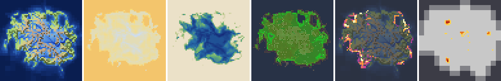
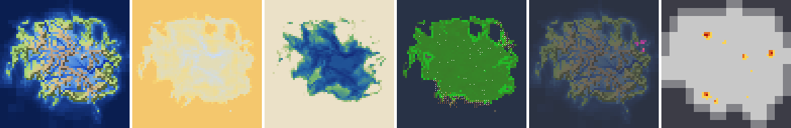
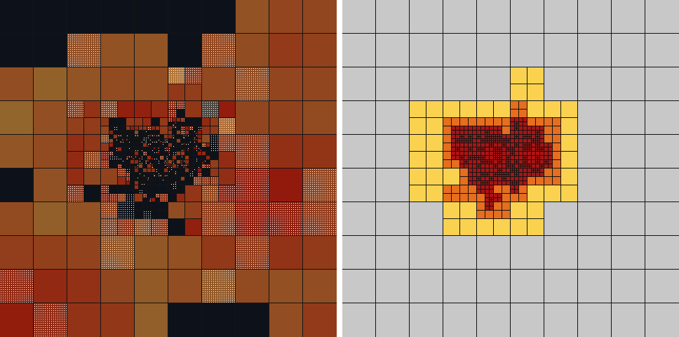
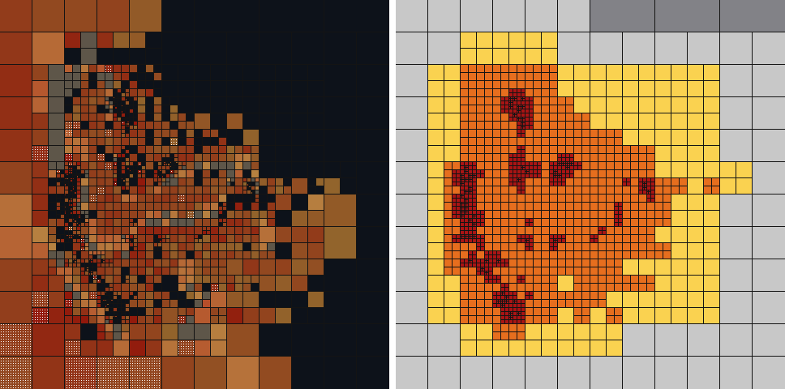
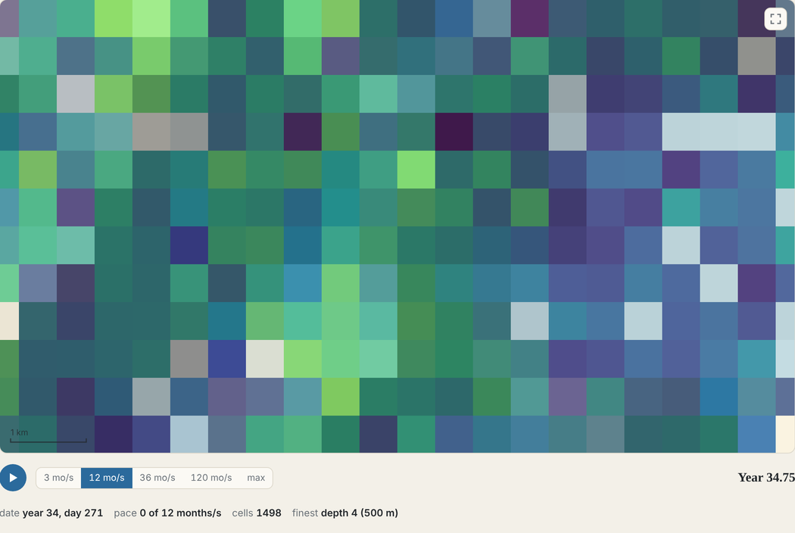

# Watch report: the first look at fine grain

For the owner (spec 12.4, plan WP12). The question: when the cells split where brains, parts and change are, does
something appear that the coarse world does not show? And does it beat the null run (spec 18.3)? "Real" is the normal
run. "Null" is the control run (`--null`: no learning, no imitation). "Coarse" keeps the cells as built. "Refined" lets
the cells split and join by the interest score (`docs/laws.md` 0). All numbers come from `series.csv`, `months.csv` and
`ew-analyze`.

**Short answer: nothing new appears at fine grain.** Fine cells make more joined structures and more gifts that go
both ways, but the null run shows the same structures, and the gifts per decision are the same as coarse. Bodies do not
go inside when it is cold. The refined cells settle on piles of parts after year 100 and then stay there.

## 1. What was run

Seed 1, the 64 x 64 island (2707 cells; 1601 land cells, most of them squares of 2 km), the roster of kinds, 300 years:

| Run | Flags beyond `ew run --size 64 --roster --years 300 --every 25 --frames-every 5 --pictures-every 50 --snapshots-every 50` |
|---|---|
| coarse real, coarse null | none; `--null` |
| refined real, refined null | `--cells 4060 --finest 6`; with `--null` |
| refined with camera | `--cells 4060 --finest 6 --camera` on the 8 x 8 squares with the most traffic at year 100 (column 52, row 17), asking depth 6 from month 1200; 150 years |
| seed 2, coarse and refined | as the real runs, `--seed 2`, to check what seed 1 showed |

The budget, 4060 cells, is 1.5 times the island's cells. Depth 6 is 125 m (a square is depth 2, 2 km). I chose 6, not
5: in a 60-year test both cost about 3 s a year. No new flag was needed: `--cells` and `--finest` exist.

**Books.** Element drift 4e-16 to 4e-15, energy drift 5e-12 to 6e-12 in all runs. A resumed run gives the same
fingerprint as the unbroken one. The camera run equals the refined run to year 100, to the last digit: the camera
changes nothing before it starts.

## 2. Speed

Measured alone on 4 cores, resuming each real run from year 250 for 50 years (ms per year):

| | All | Flow | Change | Bodies | Parts | Refine | Tape |
|---|---|---|---|---|---|---|---|
| coarse | **1117** | 183 | 30 | 817 | 38 | 0 | 33 |
| refined | **4164** | 301 | 48 | 2274 | 75 | 1401 | 47 |

Refinement makes a year 3.7 times as slow. The bodies cost 2.8 times as much because they decide 2.8 times as often
(122,000 updates a year against 43,000): a body in a fine cell steps more often. Refinement itself costs 1.4 s a year,
though it makes almost no change after year 100 (0.05 splits a year). It scores every cell and every body each month,
and with a full budget it tries each wanted split again each month (my best guess at where the time goes; not
profiled). The target is 600 ms a year; coarse misses it by a factor of 1.9, refined by 7.

The other runs ran two at a time, 2 threads each. The last 30 years: coarse null 0.39 s a year, refined null 1.8 s,
the camera run 6.8 s, seed 2 coarse 1.7 s, seed 2 refined 16.6 s (a boom: 17,000 bodies, 1.4e8 members; refinement
alone 4.5 s, as its cost grows with the bodies).

## 3. Where the fine cells went

At year 300 the refined real run holds 1415 cells finer than a square: 171 of depth 3, 167 of depth 4, 393 of depth 5,
684 of depth 6. Together they cover about 62 squares, **4% of the land**. The cells of 125 m cover 11 km². They hold
28% of the bodies, 12% of the animal mass and **70% of the parts**.

The score has a term for parts per m² (`PARTS_M2`, 1e-5 per m²). A cell of 125 m holds 15,625 m², so a single part
gives it a score of 6.4. Four quarters join only when all four score under 0.25 (or the map is over its budget, which never happens here). So a fine cell with one part never
joins again. After year 100 the map is frozen: the budget is held by piles of parts, and the change term cannot move
it.

*Refined real run, year 300. Panels: map, temperature, rain, life, traffic, cell depth (light grey a square, darker
coarser, warmer finer). The fine cells are a few small hot spots.*

*Coarse real run, year 300. The traffic follows the coast, as in the refined run.*

*Refined null run, year 300. Few bodies are left; the hot spots stay where parts lie.*

**At fine grain.** The CLI has no window frame, so I drew these from the snapshots with a small program outside the
repository (`tape::frame_window`, the same raster the live viewer gets). Left: the true colour, each cell outlined;
orange where bodies are (redder = more kg per m²); white dots where parts are. Right: the depth of each cell.

*Refined real run, year 300, squares 18 to 28 east and 13 to 23 south (20 km across). The hot spot is 388 cells of
125 m on wet ground (half a metre of liquid on the mean). They hold 546 parts and 134 bodies.*

*Camera run, year 150, the east coast (24 km across). An 8 x 8 window at depth 6 would need 16,384 cells, four times
the budget, so most of it got 250 m cells. The 288 cells of 125 m all lie under liquid: split at this grain, the low
quarters of the coast fill with the sea. 182 bodies are in them.*

**The live viewer** (`web/`, built, served, opened with Playwright): a 22 x 22 island at year 34, zoomed in. It
refines to 500 m (its limit, depth 4) under a budget of 1500 cells. Animals layer; each square is a cell of 500 m.

## 4. Watch-for table (spec 13, M0 to M3)

Means of years 200 to 300, seed 1, unless said. "Per decision" divides by `updates`. The null runs nearly die out
(coarse null: 81 bodies and 3.4e4 members at the end; refined null 391 and 2.3e5; real 3700 and 2e6 to 3e6), so I
compare shares and rates, not totals, where I can.

| Item | Verdict | Evidence: real (coarse / refined) against null (coarse / refined) |
|---|---|---|
| M0 rain falls | appeared | `rain_land` 2.87e-3 mol/m²/s in all four runs. |
| M0 rivers and lakes | appeared | `rivers` 1118 / 1191 (refined cells add river cells); `liquid_land` 1.50 / 1.64 km³. Null the same. |
| M0 rivers carve valleys | cannot tell | No height column. |
| M0 climate bands | weak | One island: `t_land_summer` 294.2 K, `t_land_winter` 280.1 K in every run. |
| M0 deserts behind mountains; weaker sun, more absorbing gas | cannot tell | Not measured, not run. |
| M1 light-eaters spread | appeared (founder) | `cover_kg` 2.2e10 in all runs; `cover_slots` 5121 / 8500 (more cells). |
| M1 eaters of eaters | did not | `ate_others` over `ate_cover`: 3.6e-4 / 7.9e-4 against 0.095 / 0.077. Real is far below null. |
| M1 kinds differ by climate | cannot tell | One climate. |
| M1 populations rise, fall, cycle | appeared (boom and bust) | Members 9e6 (years 1 to 25), 1.3e6 (50 to 100), then 2e6 to 3e6. Seed 2 booms to 1.4e8. |
| M1 extinctions | appeared | Animal kinds alive at 300: 4 / 5 of 7; null 1 / 3. |
| M2 trails | weak, not helped by grain | `worn_edges` 49 / 10, null 0 / 0. Route cards 12 / 3, null 0 / 0. Seed 2: 0 / 1. |
| M2 seasonal movement | did not | `months.csv` (years 250 to 300): the mean row of the bodies moves 0.2 squares over the year (refined 0.05). |
| M2 imitation spreads behaviour | counts only | Watches per decision 0.052 / 0.021 against 0.004 / 0.0009; `spread_max` 6.0 / 7.0 against 0.6 / 1.1. Real beats null, but no behaviour is seen to spread, and the real run starts with hand-set biases. |
| M2 signals settle | cannot tell | No signal column. |
| M2 giving | appeared (counts), not from grain | Gifts per decision 0.0086 / 0.0090 against 1e-5 / 0.0009. Refined gives 3 times as often only because it decides 3 times as often. Pairs that give both ways: 7% / 29% of giving pairs (seed 2: 5% / 13%). |
| M3 parts used as tools (edges) | appeared, very small | `edge_kg` 1.7e4 / 2.1e4 kg a year: 3.4e-4 / 4.4e-4 of what eaters eat, against 2.6e-6 / 3.1e-6 in null (100 times less). Seed 2: 5.0e-4 / 6.1e-4. Grain does not change it. |
| M3 shelters used in cold times | did not | `inside_cold` 0.165 / 0.163 and `inside_warm` 0.030 / 0.033 look like it. But `months.csv` shows the share inside does not rise in cold months: 2.8% to 3.0% (coarse) and 3.7% to 4.0% (refined) in every month, a little higher when warm (correlation with temperature +0.01 / +0.15). Bodies on cold ground live where rooms are; they do not go in when it gets cold. Seed 2 is mixed. |
| M3 containers | present, but by physics | `holding_liquid` 1157 / 1854, null 50 / 740. `liquid_held` 8.6e3 / 1.5e4 kg, null 94 / 1.3e4 kg. Refined null holds as much liquid as refined real: rain fills hollow parts. |
| M3 floating structures | cannot tell | No afloat column. |
| M3 structures that last | more at fine grain, not learned | `structures` (more than one part) 96 / 407, null 35 / 317. Seed 2: 37 / 343. Built in the first 50 years (`made_joined` 33 a year in years 25 to 50, refined), then never changed: `bonds_joined` stays at 841. At most 3 parts. |

The camera run (years 120 to 150 against the refined run): gifts per decision 0.021 against 0.010, watches 0.053
against 0.021, pairs giving both ways 154 against 98. One run, after the paths parted at year 100: cannot tell.

## 5. Fact cards (`ew-analyze`)

| Run | Groups (lasting 100 years or more) | Routes (longest, squares) | Structure kinds (copies) | of them more than one part |
|---|---|---|---|---|
| coarse real | 12 (7) | 12 (14) | 81 (21,377) | 17 kinds (39 copies) |
| coarse null | 10 (2) | 0 | 18 (58) | 5 (11) |
| refined real | 10 (9) | 3 (7) | 122 (43,106) | 58 (180) |
| refined null | 13 (6) | 0 | 61 (241) | 48 (134) |
| camera (150 years) | 9 (4) | 1 (5) | 121 (22,871) | 57 (171) |
| seed 2 coarse | 14 (9) | 0 | 61 (3,523) | 5 (12) |
| seed 2 refined | 12 (3) | 0 | 99 (5,557) | 48 (124) |

The largest group: 181 squares for 255 years (coarse), 165 squares for 250 years (refined), in the island's middle.
The most common structures are single parts (a thin slab, a hollow shell); the largest joined ones have 3 parts. The
frames the cards read are whole-map squares, so a group or a route finer than a square is not seen.

## 6. The three biggest things that did not emerge

1. **Shelter in the cold.** The share of bodies inside walls is the same in every month. Rooms exist (15,000 to 20,000
   enclosed structures) and 3% to 4% of bodies sit in them, but nothing links a cold month to going in. Best guess: **perception and
   memory**. A body sees its own cell (`sight` 1), keeps 6 numbers (`memory`), and no input says "inside is warmer
   than outside". The cold month is also rare: 2.6% of body-months are on cold ground.
2. **Building.** Joined structures are made only in the first 50 years and then never again; 2,000 to 5,000 parts a
   year are made and dropped. Fine grain makes 4 to 9 times as many joined structures, but the null run makes almost
   as many, so it is the grain (smaller cells put parts closer together), not a choice. Best guess: **learning**. A
   body gains nothing it can feel from a joined structure within its short discount, and `greedy` is 0.90 to 0.93: brains
   nearly always take their top action.
3. **Tools.** A held edge now cuts (WP2), and real bodies use it 100 times as often as null ones. But it cuts only
   0.04% of what they eat. Bodies of the refined run hold twice as many parts each, yet the edge's share does not
   rise. Best guess: **physics and perception**. Only
   rock is harder than body matter, a body sees no "edge" input, and the cover is soft enough to graze without one.

Grain did not help these three: what refinement gives is more decisions a year, not a new kind of decision.

## 7. What to change next

In the spirit of the spec (physics, perception, memory, learning; no named rule):

- **Refinement (a setting, not a law).** Score parts and brains by count in a cell, not per m², or cap the term, so a
  fine cell with one part can join again. Then the budget can follow change and the camera. Stop retrying wanted
  splits once the budget is full, so a quiet month costs nothing.
- **Perception.** Give a body the temperature of its room against its cell's ground (a number it can sense), and let it
  see one cell further in a fine cell (sight in metres, not in cells).
- **Memory and learning.** A body that sat in a room through a cold month should be able to carry that month's
  payoff forward: a longer trace or discount per second, so a season can be learned.
- **Speed.** The bodies of fine cells decide as often as their step. Fine runs cost 4 s a year; that is the price of
  watching at 125 m.
