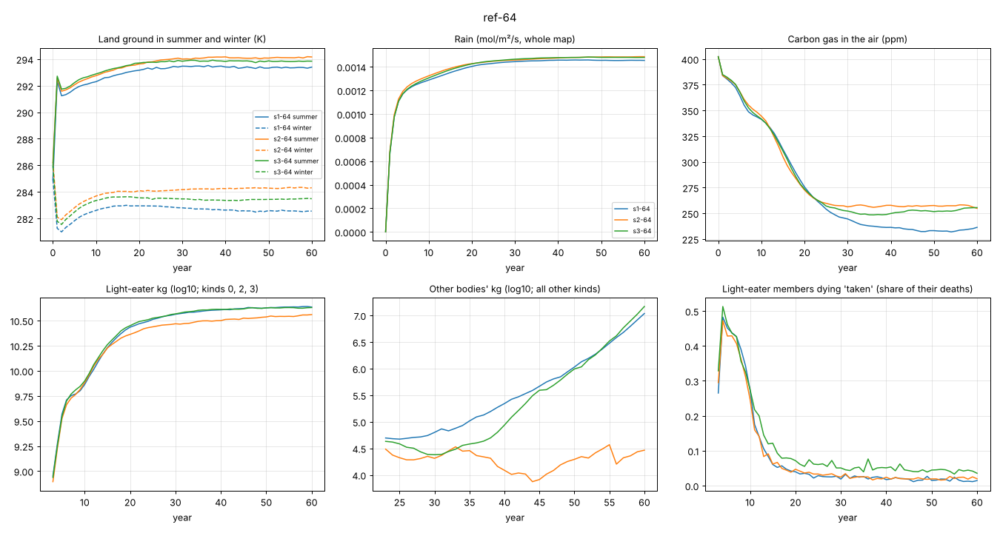
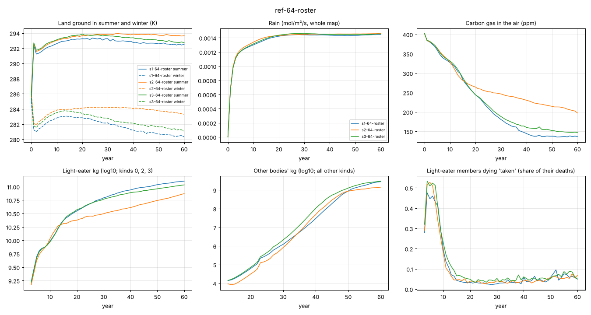
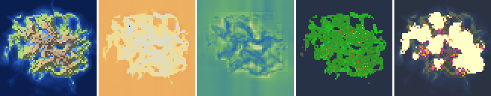
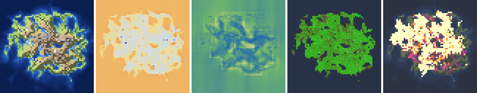
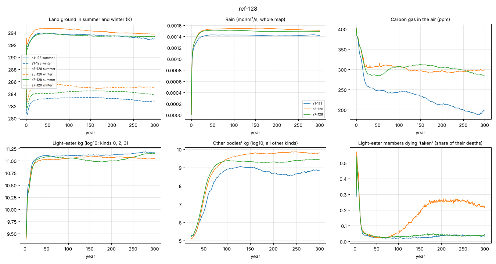
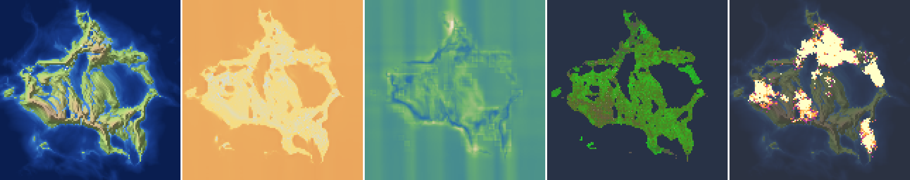
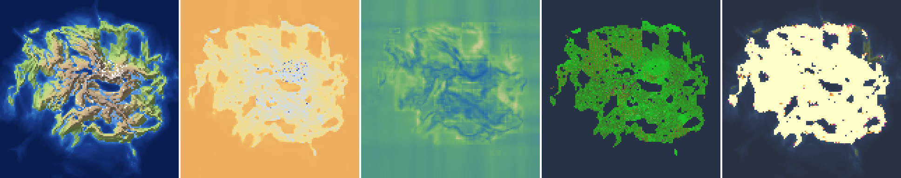
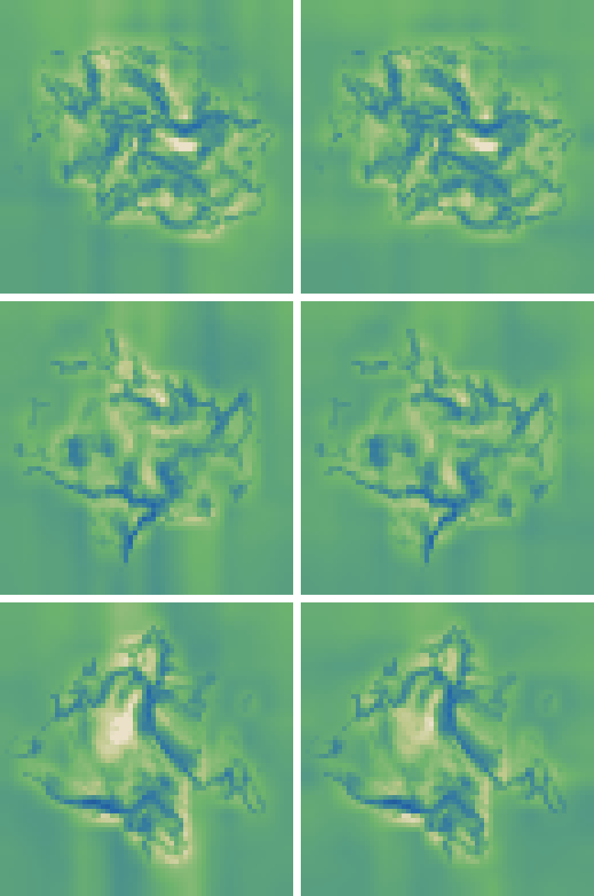

# Foundation, Phase A: prepare

Watch report for the owner (handover 12.4; `docs/foundation/plan.md`, Phase A). Pictures and run files are in
`docs/reports/foundation-a/`.

## In short

- Phase A is done: the base line is measured and saved, two possible bugs are checked, and a third bug, found by the
  long runs, is fixed. Phase B can start when you have read this.
- **Where the time goes:** bodies take about 70% of a year. Inside a body update, the biggest single cost is not the
  reactions (under 3%) but **the sums of the group brains** (`Group::weigh`, 15%): every time a node's member count
  changes, all the rows of its group's brain are summed again.
- **The reference runs** are saved: six 64 × 64 runs of 60 years and three 128 × 128 runs of 300 years. Life lasts
  300 years; the seasons hold; the carbon gas settles near 300 ppm in two seeds and falls to 200 ppm in the third.
- **The key-number test** (`tape/tests/ranges.rs`) holds ten numbers near the reference. It passes.
- **Bug (a), plants "taken" before any animal:** not a code bug. Plants take from each other, and one node rule (that
  you kept before) makes each bite kill many members. You may want to decide this rule again (see below).
- **Bug (b), stripes in the rain:** a real bug in the wind's solver. Fixed. Rain on land changes by +0.7% to +2.5%.
- **A bug found by the long runs:** a store that drains forever reached 10⁻³⁰⁸ and a division gave NaN. Fixed.
- **The code-size test** counts the code lines of `core`: 7,526 now (ceiling 9,500 until the end of Phase D).

## The tasks

| ID | What | Result |
|---|---|---|
| A1 | Where the time goes | Tables below. Profiles with `perf` on 64 × 64 worlds with life |
| A2 | Reference runs | Saved in `foundation-a/` (series, `physics.json`, the run's log, maps, charts) |
| A3 | The key-number test | `tape/tests/ranges.rs`; passes on the code before and after the wind fix |
| A4 | Two possible bugs | (a) explained, behaviour of the laws; (b) fixed |
| A5 | Your decisions in the handover | Done before this phase (17 October) |
| A6 | The code-size test | `cli/tests/core_size.rs`; passes |

## A1: where the time goes

Two profiles, each of 3 years, started from a snapshot of a reference run: a normal run at year 30 (4,600 bodies,
nearly all light-eaters) and a roster run at year 40 (8,500 bodies: 7,300 light-eater nodes, 1,200 animal nodes). The
release build with frame pointers (a build flag that gives full call stacks), `perf` at 1,000 samples a second. The
machine was shared with other runs, so the times are a little high; the shares are what matters.

**Per stage** (ms per simulated year, from the run's own clock; share of all samples from the profile):

| Stage | Normal, year 30 | Roster, year 40 | Share (normal / roster) |
|---|---|---|---|
| Bodies: their updates | 3,430 (with the survey) | 6,220 (with the survey) | 65% / 69% |
| Bodies: the survey every 3 days | (in the line above) | (in the line above) | 8% / 11% |
| Flow | 476 | 481 | 10% / 6% |
| Change | 267 | 255 | 6% / 3% |
| Parts (Bond) | 6 | 104 | under 1% |
| Tape | 128 | 162 | 10% / 8% (snapshots: gzip) |
| One body update | 42 µs | 46 µs | |

**Inside the body updates** (share of the time of the body updates; the two profiles agree within 2 points):

| Part | Normal | Roster | What it is |
|---|---|---|---|
| Group brain sums (`Life::Group::weigh`) | 15% | 15% | Each change of a node's count (deaths, joins, a child) sums all its group's brain rows again |
| Body physics (`body::physics`, mostly evaporation, inlined) | 11% | 11% | `evaporate` alone is about 5% of all time |
| Heat (`Body::thermal`, keep warm) | 8% | 7% | Melting checks of every substance at every update |
| Actions (`choose::act`) | 8% | 9% | |
| Paying upkeep (`body::pay`) | 7% | 7% | |
| Merges and splits of nodes (`nodes`) | 7% | 7% | `take_in` when a child joins a node |
| Brain (`brain::`, learning) | 7% | 6% | Mostly `brain::shake`: the mutation of a child's brain weights (all of them, for each dispersing child) |
| Children (`copy`) | 6% | 7% | Finding the node a child joins (`copy::target`) |
| The rest of `live` | 6% | 6% | |
| Exchange (gas, liquid, light, air film) | 5% | 5% | |
| Gene copies (`genes::vary`, `Life::reborn`) | 5% | 4% | New gene vectors for children |
| Perception | 3% | 4% | |
| Growth (`copy::grow`) | 3% | 4% | |
| Reactions (`Reactor`) | 3% | 3% | |
| Death | 2% | 2% | |

Inside the survey (roster profile, share of all time): the shade of the cells 4%, `Life::resum` (the group sums
rebuilt from all bodies) 2%, `nodes::crowd` 2%. Inside Flow: the exchange of ground and air 2%, drainage 1%. Inside
Change: the reactions 1.3%, the screen 1.1%.

**What this means for the plan.** The plan expected the reactions to be a big cost (task E2). They are not: 3% of the
body time. The big costs are bookkeeping: the group brain sums (15% plus 2% in the survey), the node merges and child
placement (about 15%), new gene vectors (5%) and the physics done at each update (evaporation, heat checks: about
20%). Phase E should start with the group sums (keep them by node, not by each change) and with bodies as columns.

**The snapshot is big:** 37 MB at 64 × 64 (task K2 aims at under 30 MB at 128 × 128). Compressing it is about a
third of the tape's time.

## A2: the reference runs

Made with the release build of main at `5671305` (the code of the M3 clean-up), before the wind fix of A4 (b).

**64 × 64, 60 years, seeds 1, 2, 3** (`s1-64` to `s3-64`, and `--roster`: `s1-64-roster` to `s3-64-roster`):

| Run | Bodies at year 60 | Light-eater members | Animal members | Drift of elements, energy | Time per year |
|---|---|---|---|---|---|
| s1-64 | 6,032 | 5.5e10 | 1.7e5 | 1.8e-14, 4.5e-14 | 6.7 s |
| s2-64 | 4,521 | 3.9e10 | 466 | 2.2e-14, 2.1e-14 | 5.8 s |
| s3-64 | 5,128 | 4.9e10 | 2.8e5 | 1.8e-14, 2.2e-14 | 6.3 s |
| s1-64-roster | 10,387 | 1.5e10 | 3.0e9 | 2.5e-14, 6.2e-14 | 10.7 s |
| s2-64-roster | 8,632 | 1.3e10 | 5.8e8 | 3.2e-14, 1.2e-13 | 8.8 s |
| s3-64-roster | 10,005 | 1.2e10 | 2.2e9 | 2.7e-14, 9.2e-14 | 10.9 s |

(Three runs went at the same time on 4 cores, so the times are high.)

What the charts show:
- The land is about 293.5 K in summer and 283 K in winter. Rain settles at year 20.
- **The carbon gas falls** from 400 ppm to about 250 ppm in normal runs and to 140 to 200 ppm in roster runs, and has
  not settled at year 60 in the roster runs. Life stores carbon and nothing gives it back fast enough (handover 13.2,
  "Carbon": no source). The winters of the roster runs get colder by about 3 K over 60 years.
- In normal runs the eaters grow about 0.25 in log10 kg a year at year 60 in seeds 1 and 3; in seed 2 they stay at
  about 10⁴ kg. In roster runs the animals reach 10⁹ kg and settle.

Maps of year 60 (map, temperature, rain, life, traffic):

**128 × 128, 300 years, seeds 1, 5, 7** (`s1-128`, `s5-128`, `s7-128`, with `--features threads`; the three ran
at the same time, 2 threads each):

| Run | Years | Bodies at the end | Light-eater members | Animal members | Drift of elements, energy | Time per year |
|---|---|---|---|---|---|---|
| s1-128 | 300 (crash in 285, fixed, years 281–300 run again) | 27,614 | 9.0e10 | 1.4e7 | 1.1e-14, 1.6e-14 (from 280) | about 30 s |
| s5-128 | 300 | 25,386 | 5.7e10 | 1.3e8 | 1.4e-13, 5.2e-14 | 28 s |
| s7-128 | 300 | 26,042 | 1.2e11 | 6.0e7 | 9.1e-14, 4.0e-14 | 40 s |

**Seed 1 crashed in year 285** with an undefined number (NaN) in the wind. This is a real bug that only the long run
found (see "A bug found by the long runs" below). After the fix, seed 1 ran on from its year-280 snapshot to year 300
(the code of main with both fixes), so its last 20 years are on the new code.

The handover (13.2, "Long runs") asked five questions about these runs:

| Question | Answer (seeds 1, 5, 7) |
|---|---|
| Does life last? | Yes. Light-eaters hold at about 10¹¹ kg from year 30 to the end; eaters settle at 10⁹ to 10¹⁰ kg from year 100. Three or four kinds by the clustering. |
| Do plants evolve their light gene? | Slowly: the mean light catalyst gene goes from 11.30 to 11.40–11.49 (log10) in 300 years. |
| Does fixing fall by itself? | Not clearly. 10% of the founders carry the fixing gene; by year 10 it is 48–65% of the members; at year 300 55%, 22% and 58%. It goes up and down, without a trend. |
| Do the seasons hold? | Yes: summer 293–294 K, winter 283–285 K on land, the same at year 100 and year 300. |
| Where does the carbon gas settle? | Seeds 5 and 7: about 290–300 ppm from year 30 on. **Seed 1 does not settle**: 245 ppm at year 100, 190 ppm at year 280, 197 ppm at year 300. |

In seed 5, the share of plant members dying "taken" rises from 3% to 25% after year 100: there, animals take from
plants, which is the law at work (the eater mass is the highest of the three seeds).

Maps of year 300:

## A3: the key-number test

`tape/tests/ranges.rs` (slow, `#[ignore]`, CI runs it): seeds 1, 2, 3 of `ew run --size 64`, 30 years each, on
threads. Each number is the mean of the three seeds, against the mean of the same seeds in the reference runs.

| Number | Reference | Seeds (lowest, highest) | Range | Before the wind fix | After |
|---|---|---|---|---|---|
| Ground temperature on land, years 21 to 30 | 289.31 K | 288.88, 289.69 | ±1 K | 289.31 | 289.19 |
| Seasonal swing on land | 10.19 K | 9.81, 10.46 | ±1.5 K | 10.19 | 10.03 |
| Rain on land | 1.496e-3 mol/m²/s | 1.482e-3, 1.517e-3 | ×/÷ 1.3 | 1.496e-3 | 1.527e-3 |
| Carbon gas | 257.7 ppm | 254.5, 260.3 | ±40 ppm | 257.7 | 259.4 |
| River cells | 380 | 304, 449 | ×/÷ 1.5 | 380 | 390 |
| Land worn down, years 21 to 30 | 0.051 mm/yr | 0.048, 0.054 | ×/÷ 2 | 0.051 | 0.052 |
| Light-eaters, year 30 | 10.53 log10 kg | 10.47, 10.57 | ±0.3 | 10.53 | 10.52 |
| Eaters, year 30 | 4.50 log10 kg | 4.31, 4.80 | ±0.3 | 4.50 | 4.62 |
| Life of light-eaters, year 30 | 1.90 yr | 1.58, 2.08 | ×/÷ 2 | 1.90 | 1.75 |
| Life of eaters, year 30 | 2.91 yr | 2.13, 4.29 | ×/÷ 2 | 2.91 | 3.68 |
| Books | | | 1e-12 | kept | kept |

After the wind fix every number stays in its range; rain on land rises 2%, as in A4 (b), and the
other changes are inside the seeds' spread.

No range was tighter than the seeds' own noise, so none was widened. Two are close for one seed alone: eater kg (seed 1
is 0.30 above the mean) and eater life (the seeds differ by 2 times). The test checks the three-seed mean, which is
about 2 to 4 times steadier.

"Adult life" is read as `root_<k>_life_real` (members standing over deaths in the year: the life really lived). The
other column, `root_<k>_life` (the life the genes allow), jumps from 180 to 75,000 years for plants, so it cannot be a
key number.

To give the test its numbers in one place, the series has three new columns: `t_land` (the mean of the year's months),
`rain_land` and `rivers`. The river count moved from the CLI into the tape (`tape::dry_land_flux`).

## A4: two possible bugs

### (a) Plant members die "taken" in years 3 to 5, before any animal

**True, and not a code bug.** Only light-eaters live in years 3 to 21 of a normal run, so every "taken" death is a
light-eater node taking from another light-eater node of its cell.

| Taken, as a share of all plant deaths | Seed 1 | Seed 2 | Seed 3 |
|---|---|---|---|
| Year 3 | 27% | 30% | 33% |
| Year 4 | 48% | 47% | 51% |
| Year 12 | 14% | 14% | 20% |
| Year 21 | 3.3% | 4.1% | 6.1% |
| Years 3 to 21 together | 8.0% | 7.8% | 11.7% |

The chain of causes:
1. Plants start with neutral brains and a spray of mutations: the bias to take from a body is -2.5 to +2.8. So some
   plants choose "take" (about 3,000 successful bites a year of 60,000 to 85,000 decisions). They have the force and
   the uptake genes, so the laws allow it.
2. They take stores, not body matter: mostly liquid, and up to half (`MAX_TAKE_SHARE`) of the small stores (the
   dissolved rock salt 23, the soil mineral 24, the fat 6, the char 7).
3. **The amplifier:** when a bite is more than one member's body, it kills members by **the largest share it takes of
   any store** (`core/src/choose/feed.rs:109`), not by the weight of the bite. Taking half of a trace store kills half
   the node. The mean bite weighs 3% of the target, but kills 35% of its members on average. Per year, the body killed
   is 16 to 21 times the mass taken.
4. This rule is in `docs/laws.md` 6.8. The rule "by the weight of the bite" was tried and not kept (`docs/history.md`,
   commit `5679524`). The old handover named it as "the place to look if taking is judged too deadly".

**A test only, not kept** (seed 1, 64 × 64, 8 years): with "by the weight of the bite", taken deaths fall 10 to 20
times and plants are 65 to 75% more at year 8 (members 3.6e9 → 6.0e9; body mass 5.9e6 t → 1.0e7 t).

**Your decision:** keep the rule (it is a law you chose), or change it to the weight of the bite. Changing it is a law
change, not a bug fix, so I did not do it.

### (b) Stripes in the rain map

**True, and a bug.** Over the sea, the rain had north–south stripes a few air nodes wide (on the open sea, node rain
changed 2.0 to 2.7 times more between east–west neighbours than between north–south ones).

The cause: the wind is solved line by line, first all east–west lines, then all north–south lines. One call covers
3 days, which is long against how fast the air mixes, so the air kept the pattern of the lines solved last. Swapping
the order turned the stripes east–west; turning the overturning off removed them.

The fix (`core/src/flow/air/wind.rs`): the lines are solved in both orders from the same start, and the air keeps the
mean of the two (Strang 1968). The books stay exact. Left before, right after (seeds 1, 2, 3, year 5, without life):

Effect (5 years without life, 64 × 64): rain on land +0.7% to +2.5%; temperatures change by 0.03 K or less; Flow is
about 5% slower (the wind runs twice). Golden fingerprints re-pinned.

## A bug found by the long runs: NaN from a store that drains forever

Seed 1 at 128 × 128 stopped in year 285. The chain of causes:
1. Under a hill top, the store of liquid in the bed loses a share at every liquid step and nothing refills it. A share
   of a share never reaches 0: after 285 years it held about 10⁻³⁰³ mol.
2. Its spring was the only flow out, of 5 × 10⁻³⁰⁹ m³. `liquid::send` shared what leaves by `1 / (sum of the flows)`,
   which is infinite for such a small number, and 0 × infinity is NaN (undefined).
3. The NaN went into the ground of the cell and its 8 neighbours, then radiation put it into their air, and the wind
   stopped on it.

The fix (`core/src/flow/liquid.rs`): each outlet takes `q / (sum of the flows)`, which is never more than 1. The same
risk was in `drain::stores` (0 / 0 when such a flow rounds to 0); there nothing comes in, so nothing spills. The law
is the same; only the rounding changes (golden fingerprints re-pinned). Main without the fix also breaks in year 285;
with it, the run passes and keeps its books (drift 1e-14 at year 300).

## A6: code size

`cli/tests/core_size.rs` counts the code lines of `core/src` (not blank, not comments) and fails above 9,500 (8,000
from the end of Phase E).

| Folder | Code lines |
|---|---|
| `core/src/*.rs` (top level) | 1,805 |
| `flow/` | 1,633 |
| `body/` | 1,314 |
| `change/` | 759 |
| `bond/` | 715 |
| `choose/` | 630 |
| `copy/` | 356 |
| `chem/` | 314 |
| **core** | **7,526** |

Phase A added 18 lines to `core` (the wind fix and the NaN fix). The rest of the work was in `tape/`, `cli/` and the
tests.

## Speed (the base line for the plan's goals, 6.5)

Measured on a quiet machine (4 cores), one run at a time, with the release build of `5671305` (before the wind fix):

| World | Flow | Change | Bodies | Tape | Time per year |
|---|---|---|---|---|---|
| 64 × 64 without life (5 years) | 354 ms | 280 ms | 25 ms | 42 ms | 0.73 s |
| 128 × 128 without life (5 years) | 1,436 ms | 1,166 ms | 116 ms | 162 ms | 2.9 s |
| 64 × 64 roster, years 40 to 43 (8,500 bodies) | 475 ms | 237 ms | 6,183 ms | 153 ms | 7.2 s (46 µs per body update) |
| 128 × 128, years 100 to 300 (19,000 to 26,000 bodies; three runs at once) | 2.2–2.5 s | 0.9–1.2 s | 20–40 s | 0.4 s | 28–40 s (48–52 µs per body update) |

The speed benchmark of the tests (`speed`: 32 × 32, every kind, 5 years) on main after the wind fix: **0.40 years per
second** (3,157 bodies at the end).

The plan's goals against these numbers: the island without life 3 times faster in Flow and Change (from 2.6 s a year
at 128 × 128 to under 0.9 s); the island with life 10 times faster per year at the same number of bodies (from about
30 s a year at 128 × 128 to about 3 s).

## What comes next

Phase B: the base layers (space, store, clock). From A1, two things to keep in mind for later phases:
- the group brain sums and the node bookkeeping cost more than the reactions; E1 (bodies as columns) and E4 (brains
  of a group as one block) matter most;
- snapshots are large; K2.

Open for you:
1. The bite rule of (a): keep, or by the weight of the bite?
2. The carbon gas still falls at year 60 in roster runs (to about 140 ppm), and in the 128 × 128 run of seed 1 it falls
   to about 200 ppm in 300 years. This is the known missing carbon source (handover 13.2, "Carbon"), not new; M4's
   slow carbon source is the place for it.
