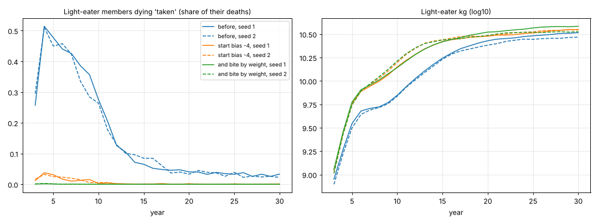

# Foundation, Phases B and C: the base layers and the shared maths

Watch report for the owner (handover 12.4; `docs/foundation/plan.md`, Phases B and C). Pictures are in
`docs/reports/foundation-bc/`.

## In short

- **Phases B and C are built.** The new base is in place beside the old code: SPACE (`core/src/space/`), STORE
  (`core/src/store/`), CLOCK (`core/src/clock/`) and SOLVE (`core/src/solve/`). No law uses most of it yet; Phase D
  moves the laws onto it and deletes the old special code.
- **The world is the same.** Every refactor kept the history bit for bit: the yearly and monthly series of test runs are
  byte for byte the same before and after. The fingerprints (a hash of the saved world) were re-pinned only where the
  saved format changed (the clock, the boundary nodes, sleep and wake) or a law changed (your bite decision).
- **Your bite decision is in.** Plants start with a strong bias against taking from a body, and a bite kills members by
  its weight. Plant deaths by "taken" fell from about 8% to almost 0, and plants are about 2 times more in years 5 to
  15. All ten key numbers stay in their ranges.
- **Size:** `core` has 8,344 code lines (ceiling 9,500 until the end of Phase D; 8,000 after Phase E). The new
  base uses 779 of its 2,350 allowance.
- **One task measured and not built:** B4 (sparse amounts) would save only about 3% of memory. The memory goes to the
  bodies' born brain rows (about 60% of a living world), which Phase E handles.

## Your bite decision

Two changes, each its own commit:
1. **The start** (`worldgen/src/life/seeding.rs`): light-eater founders keep a bias of -4 against taking from a body
   before their mutation spray. -4 is the value the hand-set plant brain already used, so no new number. Before, the
   bias spread from -2.5 to +2.8; now from -6.6 to -1.2: no founder starts with a wish to bite.
2. **The law** (`core/src/choose/feed.rs`, `take_body`): a bite of a member's body or more kills the same share of
   members as the share of the body it tears: its weight, or the share of body matter it eats if that is more (eaten
   matter is torn body). Before, it killed by the largest share it took of any store, so taking half of a trace mineral
   killed half the node. What the taker takes beyond the dead members' share comes from the living members, so the
   books stay exact. One rule now covers single bodies, grazing and nodes.

| 64 × 64, 30 years | seed 1: before / start / law | seed 2: before / start / law |
|---|---|---|
| plant deaths "taken", years 3–21 | 7.9% / 0.18% / 0.004% | 8.1% / 0.17% / 0.004% |
| plant members, year 10 | 5.2e9 / 9.8e9 / 1.00e10 | 4.7e9 / 1.18e10 / 1.17e10 |
| plant kg, year 30 | 3.3e10 / 3.5e10 / 3.8e10 | 2.9e10 / 3.5e10 / 3.4e10 |
| eater kg, year 30 | 3.9e4 / 2.9e4 / 3.9e4 | 2.9e4 / 2.7e4 / 1.5e4 |

The key-number test passes after both (light-eaters 10.58 log10 kg against 10.53 ± 0.3; eaters 4.52 against
4.50 ± 0.3).

## What was built

| Task | What | Where | Code lines | Check |
|---|---|---|---|---|
| B1 | **The mesh:** levels of cells (area, centre, latitude), links each once (two cells, distance, width of the shared border: 0 for a diagonal), compressed neighbour lists, parents and children between levels. The square builder gives today's grid; the air grid is the next coarser level. `Grid` is now a thin view on the mesh (one source of the geometry). | `space/mod.rs`, `space/square.rs`, `grid.rs` | 268 (space) | same history |
| B2 | **Stacks:** layers above and below each cell with vertical links (today: deep store, ground, air). | `space/stack.rs` | (in space) | same history |
| B3 | **The node table:** every ground, air and deep node (and now the three boundary nodes) has an id (slot and generation), a class, a parent and a cell. The amounts stay in their arrays; the table says where they live. It is rebuilt from the grid, not saved (honest while no node is added or removed; F1 must save it). | `store/nodes.rs` | 258 (store) | same history |
| B5 | **Moves, transforms and link fluxes, and `apply`:** the one way a law will change the world. If a node would go below zero, every change that takes from it is scaled down by one factor, so matter and heat stay together; the scaling is counted. 10⁶ random changes keep every element and the energy to 2e-16. | `store/moves.rs` | (in store) | same history |
| B6 | **Sun, space and outside are boundary nodes.** The `Ledger` is deleted; its numbers are what these three nodes hold. One helper books a crossing (`World::cross`); the books are one check: the world's change equals what the boundary nodes gave. | `store/`, `world.rs`, `check.rs` | (in store) | same history |
| B7 | **The clock:** time is whole seconds (`World::time`); day, month, year and season come from it. The month runs as a list of processes with periods, in one fixed order. | `clock/mod.rs`, `schedule.rs` | 87 (clock) | same history |
| B8 | **Sleep and wake:** a node sleeps until an alarm, or until a move brings it more than 5% of what it holds (`wake_share`, the first row of a new table of speed settings in `docs/numbers.md`). One queue per class, saved, in a fixed order. | `clock/sleep.rs`, `store/moves.rs` | (in clock) | same history |
| B9 | **Random numbers by node and time:** a stream keyed by a node id and seconds, apart from today's keys. | `rng.rs` | 14 | same history |
| B4 | **Sparse amounts:** measured, not built (below). | — | 0 | — |
| C1 | **`spread`:** one implicit step (stable for any step length) of anything that moves from high to low along links: heat, pore liquid, gases. Conjugate gradient; it stops when solved, with a cap on rounds. It returns what crossed each link, and each node moves only by those, so the books are exact. | `solve/spread.rs` | 166 (solve) | — |
| C2 | **`downhill`:** the cells sorted from high to low and one pass that moves liquid down, with what crossed each link. On test ground with rain it gives the same end state as today's sweep (to rounding), about 1.3 times faster. | `solve/downhill.rs` | (in solve) | — |
| C3 | **`lines`:** the wind's line solver moved into `solve/`. | `solve/lines.rs` | (in solve) | same history |
| C4 | **Big step against small steps** for every solver: `spread` and `lines` keep the first error term of the implicit step; `downhill` moves one rain in one pass as in four parts. | `core/tests/solve.rs` | (tests) | — |

**Deleted in these phases:** the `Ledger` and its hand bookkeeping in each edit (`life::book`), the wind's own line
solver, the geometry inside `grid.rs` (now the mesh), the calendar sums spread over the laws (now the clock), and the
deep-store sizing copy in `flow/drain.rs`. The large deletions (`change/screen.rs`, the liquid sweep, creep, the
bodies' ring, the pools) are Phase D and E: they need the laws to move onto the new base first.

## Code size

| Part | Code lines | Allowance |
|---|---|---|
| `space/` | 268 | 500 |
| `store/` | 258 | 700 |
| `clock/` | 87 | 250 |
| `solve/` | 166 | 350 |
| **core** | **8,344** | ceiling 9,500 now, 8,000 after Phase E |

At the start of Phase B `core` had 7,526 code lines. Phase D must delete at least 600 and Phase E at least 600 for
`core` to be at or under 8,000 at the end of Phase E (plan, "The line budget").

## B4: why sparse amounts were not built

| 128 × 128 | without life, year 3 | with life, year 4 |
|---|---|---|
| The saved world | 19 MB | 186 MB |
| Amount arrays (ground, bed, deep, air) | 10.4 MB (54%) | 10.4 MB (6%) |
| Born brain rows of bodies | 0 | 108 MB (58%) |
| Bodies | 0 | 38 MB (20%) |

Sparse amounts would save about 5 MB at 128 × 128 with life, about 3% of the world at planet size, and every law reads
the arrays directly. Flow already loops only over the substances present. So, by the main rule ("if the general way
does not fit, stop and tell the owner"), it was not built. **The memory is in the born brain rows** (about 6 KB a
body): this is a Phase E question.

## Decisions I took as architect (tell me if you disagree)

1. `spread` stops when the answer is solved (a residual below 10⁻¹² of its start), with a cap on rounds. A fixed
   number of rounds, as the plan suggested, can leave stiff links far off: the books stay exact, but the values are
   wrong. Stopping when solved is still the same answer for the same inputs.
2. The plan's `Reaction` is named `Transform` in the store (the chemistry already has a `Reaction`; CLAUDE.md bans two
   things with one name). It has no heat field: the heat of reaction follows from the substances.
3. The node table is rebuilt from the grid on load, not saved. F1 (split and join) must save it.
4. One `Boundary` class holds the sun, space and outside nodes (a class says how a node is stored).
5. Flow's own periods (exchange, wind, liquid, creep) stay inside `flow::step` until Phase D rewrites those parts.

## For Phase D

- `store::apply` builds work arrays the size of the whole world at each call: fine for tests, too slow for the laws.
  D must give it work space kept between calls, or book only the nodes touched.
- `wake_share` (5%) covers amounts and heat. Heat is counted from 0 K, so 5% is about 15 K: too coarse for the
  chemistry (today's screen uses 0.5 K). D6 needs its own rule for heat.
- `flow/scratch.rs` still keeps its own copies of the geometry; `Grid::air_share` assumes every air node covers 16
  cells, which is wrong at the edge when the map side is not a multiple of 4. D3 and D9 take both from the mesh.
- A `Move` does not carry the potential energy of lifting gas into the air; D must decide it when the air moves onto
  `apply`.

## Speed

No law uses the new base yet, so the speed is unchanged (Phase A's base line holds: about 2.9 s a year at 128 × 128
without life, about 30 s with life). Phase D's goal: Flow and Change at least 2 times faster.

## Checks

On main after the last merge: the normal suite (29 test groups) passes; clippy gives no warnings; the wasm build passes;
the golden runs keep their pins and the threads build gives the same fingerprints; CI runs the slow tests (the
key-number test included).
