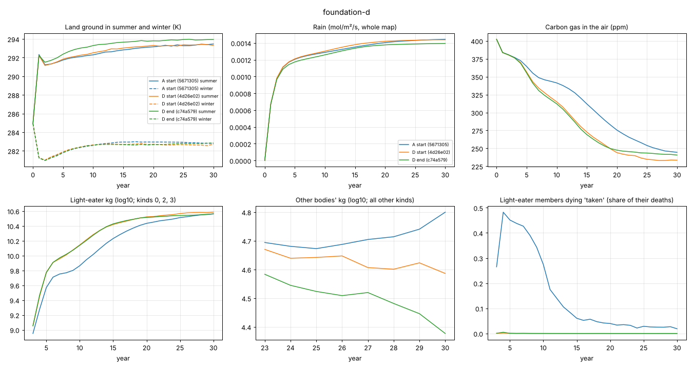
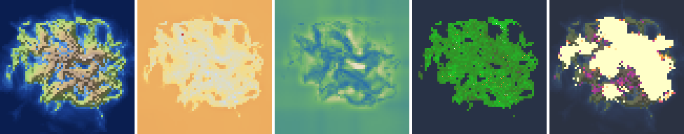

# Foundation, Phase D: the physics laws on the new base

Watch report for the owner (handover 12.4; `docs/foundation/plan.md`, Phase D). Pictures are in
`docs/reports/foundation-d/`.

## In short

- **Every task of Phase D is built and on main.** Flow, Change and Bond now run on the new base: the mesh, the
  store's one way to change the world (`store::apply`), the clock's sleep and wake, and the shared solvers. `grid.rs`
  and `change/screen.rs` are gone. A test (`cli/tests/contract.rs`) checks that no law writes the world's arrays
  directly, except ten named files that wait for Phase E (bodies) and Phase F (the bed).
- **The world is the same world.** All ten key numbers stay in their ranges, and the chemistry with sleep matches the
  chemistry with every node awake.
- **Two goals of the phase are NOT met. You must decide what to do.**
  1. **Speed.** The goal was Flow and Change at least 2 times faster. Without life, Flow is about 30% SLOWER and Change
     about 10% faster. With life, Change is about 2.6 times slower. The whole year is about 10% slower.
  2. **Size.** The goal was to delete at least 600 code lines. `core` grew by 389 lines (8,344 to 8,733). It is still
     under the ceiling of 9,500, but Phase E must now delete about 730 lines to reach 8,000.
- **Why:** the new base books every change of the world through one checked path (`store::apply`) and runs the
  physics more often and more exactly (liquid and erosion at every liquid step, the wind on links, gas between ground
  and air as fluxes). That is more honest and more general, but it costs time. The big savings left change the world
  a little; they are your choice (below).

## What was built

| Task | What | Check | Code lines |
|---|---|---|---|
| D0 (added) | `store::apply` fast enough for the laws: work space kept between calls, only the touched numbers, "book first, check after" | same results | store +92 |
| D1 | Ground heat between cells by `spread`, **once a year** (on 2 km cells heat needs about 70,000 years to cross a cell; the implicit step allows any length) | world changes very little | flow +38 |
| D2 | Surface liquid by `downhill` in one pass; pore liquid and the deep store by `spread` on the cell's stack; the store takes from a node only its net loss | level 3, ranges hold | flow −46 |
| D3 | The air on the mesh: exchange through the parent relation, cell shares from areas, wind on the air level's links (lines on squares, `spread` on any mesh; tested on a triangle mesh); the wind books through `apply` | level 3, ranges hold | flow +110 |
| D4 | Radiation reads latitude and area per cell from the mesh | same results | flow +6 |
| D5 | Erosion at every liquid step, along the downhill pass (the 7-month sample goes) | level 3 | (in D2) |
| D6 | Change's nodes sleep by the clock; **`change/screen.rs` deleted** | level 3, sleep test passes | change −292 |
| D7 | Parts are store nodes (ids saved, slots reused with a new generation); bonds are one link list; the enclosure is one link | same results | bond +20, store +29 |
| D8 | Cleared lanes are the first link field (`store::Links`) | same results | +20 |
| D9 | Flow, Change and Bond book through the store; potential energy is a store node; gas between ground and air as fluxes; **`grid.rs` deleted**; the contract test | level 3, ranges hold | about +150 |
| D10 (added) | Speed pass: cheaper booking, a simpler sleep queue, the reactor only over reactions that can run | same results | +51 |

Three bugs were found and fixed on the way: an air node reacted with a liquid film it did not have (D9); a column of
`apply` could ask of two numbers per link with room for one (D2); and the wind clipped gas a node had not received yet
in the order of its lines (D3).

## The same world

Seed 1, 64 × 64, 30 years, with life, at three points of the work: the start of Phase A (`5671305`, the reference),
the start of Phase D (`4d26e02`, after your bite decision) and now (`c74a579`).

- Temperatures, rain and plants follow the same curves. Since Phase D the land's summer is about 0.5 K warmer and rain
  about 3% lower; the carbon gas falls as before.
- The eaters of this one seed end lower: 10^4.4 kg now, 10^4.6 at the start of Phase D, 10^4.8 at the start of Phase A.
  Over three seeds the key number holds (below), so this is mostly the noise of one seed.
- Plants are higher from year 5 to 20 since your bite decision (Phase B/C), not since Phase D.

**Key numbers** (three seeds, 30 years, 64 × 64; `tape/tests/ranges.rs`): all ten hold.

| Number | Reference (Phase A) | Now | Range |
|---|---|---|---|
| Ground temperature on land | 289.31 K | 289.46 K | ±1 K |
| Seasonal swing on land | 10.19 K | 10.78 K | ±1.5 K |
| Rain on land | 1.496e-3 mol/m²/s | 1.427e-3 | ×/÷ 1.3 |
| Carbon gas | 257.7 ppm | 249.6 ppm | ±40 ppm |
| River cells | 380 | 458 | ×/÷ 1.5 |
| Land worn down | 0.051 mm/yr | 0.052 mm/yr | ×/÷ 2 |
| Light-eaters, year 30 | 10.53 log10 kg | 10.56 | ±0.3 |
| Eaters, year 30 | 4.50 log10 kg | 4.51 | ±0.3 |
| Life of light-eaters | 1.90 yr | 2.32 yr | ×/÷ 2 |
| Life of eaters | 2.91 yr | 3.35 yr | ×/÷ 2 |

River cells rose about 1.2 times with D2 (the new liquid pass). The cause is not proven: the one-step pour test gives
the same result as the old sweep, so it is likely the deep store and pore flow on the stack, which now cross only real
borders (no corners).

**Sleep against no sleep** (`the_sleep_of_change_keeps_the_chemistry`): carbon gas, the two minerals on land and sea
and the dead matter agree with "every node awake every step" within 4 to 60 times less than their own noise, at the
sleep of 90 days and at 45 and 180.

Map of year 30 now (map, temperature, rain, life, traffic):

## Speed: the goal is not met

Measured on a quiet machine, one run at a time (ms per simulated year):

| World | Phase A start | Phase D start | Now |
|---|---|---|---|
| 128 × 128 without life: Flow | 1,340 | 1,430 | 1,880 |
| 128 × 128 without life: Change | 1,240 | 1,210 | 1,080 |
| 64 × 64 with life, year 30: Flow | 493 | 513 | 743 |
| 64 × 64 with life, year 30: Change | 269 | 245 | 635 |
| 64 × 64 with life: the whole year | 5.3 s | 4.9 s | 5.4 s |

Where the time goes now (profile, 128 × 128 without life): the liquid about 24% (the underground flow 7%, the
downhill pass 6%, its booking 6%), the chemistry about 31%, the exchange of ground and air 11%, the store's booking
about 15% before the speed pass.

**Why Change is so much slower with life:** more nodes wake and react, because everything Flow brings now goes through
`apply` and wakes a node when it brings more than 5% of what the node holds; with life there are more such moves. This
is correct by the store's rule, but the 5% (`wake_share`) and the chemistry's own calm share (`CALM`, 5%) were never
tuned for it.

**Options that change the world a little (your choice; each needs the key-number test):**

| Option | Saving (measured or estimated) |
|---|---|
| The chemistry's calm share `CALM` from 0.05 to 0.5 (nodes near balance sleep longer) | Change −34% (one run, 128 × 128) |
| A larger `wake_share` (fewer wakes from what passes) | most of the air's reactions with life |
| The underground liquid every second liquid step | about −7% of Flow |
| Liquid every 30 days instead of 15 (`flow_days`) | about −10% of all |
| Exchange every 6 days instead of 3 (`exchange_days`) | about −5% of all |

The plan's way to most of the speed is Phase E (bodies are about 80% of a living year) and Phase J (threads by
chunks). Phase D's own target looks out of reach without one of the options above.

## Size: the goal is not met

| Folder | Phase D start | Now | Change |
|---|---|---|---|
| top-level files | 1,860 | 1,830 | −30 (`grid.rs` gone) |
| `flow/` | 1,620 | 1,749 | +129 |
| `change/` | 759 | 571 | −188 (`screen.rs` gone) |
| `bond/` | 714 | 735 | +21 |
| `store/` | 258 | 686 | +428 |
| `space/`, `solve/`, `clock/` | 521 | 548 | +27 |
| `body/`, `choose/`, `copy/`, `chem/` | 2,612 | 2,614 | +2 |
| **core** | **8,344** | **8,733** | **+389** |

The plan's deletion list for Phase D, and what happened:

| Item | Done? |
|---|---|
| `change/screen.rs` | Deleted |
| `grid.rs` | Deleted |
| The sorted sweep, `pore_flow` and the sampled work of `flow/liquid.rs` | Deleted (replaced by `downhill`, `spread`, erosion every step) |
| Most of `flow/drain.rs` | Its movers deleted; it keeps the physics (rates and conductances) |
| Most of `flow/scratch.rs` | Partly: the geometry copies and many helpers went; the four-node air interpolation stays (replacing it changes the world) |
| The heat part of `flow/creep.rs` | Was already gone before the plan; D1 added the general form instead |
| `ground.rs`'s `draw`, `take_paid`, `take_heat` | `take_heat` deleted; `draw` and `take_paid` stay because bodies use them (Phase E7) |
| The enclosure heat code of `bond/` | Became one enclosure link (about the same size) |

The store grew most: the fast paths, the net-loss rule, the boundary and potential nodes, batching. It is the one
place that does what many laws did by hand, but the laws' old code was smaller than the general machinery.

## Decisions I took as architect (tell me if you disagree)

1. **Sideways ground heat once a year**, not every step (D1): on 2 km cells it is far too slow to matter at 3 days, and
   every step cost Flow 30%.
2. **The store's net-loss rule** (D2, D3): a link flux takes from a node only its net loss over all its links. Liquid
   and wind pass more through a node in one step than it holds; scaling by the gross flow wrongly stopped them.
3. **Potential energy is a node of the store** (D9), so the lift of gas and the fall of liquid are fluxes like the rest.
4. **The bed stays outside the store until Phase F** (patches), with one write path (`World::loosen`).
5. **Waking by net change** (D9): what only passes through a node does not wake it.
6. **The speed pass (D10)** was added to the plan; it kept results bit for bit.

## What comes next

Before Phase E, please decide:
1. **Speed:** accept Phase D as it is and go on (Phase E targets the bodies, about 80% of a living year), or first try
   one or more of the options above (each a small, measured change of a speed setting or a calm share).
2. **Size:** Phase E must delete about 730 code lines for `core` to reach 8,000. The plan expects E8 ("a body is a
   node with links to its cell") to delete most of `body/physics.rs` and `body/exchange.rs`, the pools and the ring.

## Checks

On main (`c74a579`): the normal suite passes (30 test groups); clippy gives no warnings; the wasm build works; the
golden runs keep their pins, also with threads; the key-number test and the sleep test pass; CI runs the slow tests.
