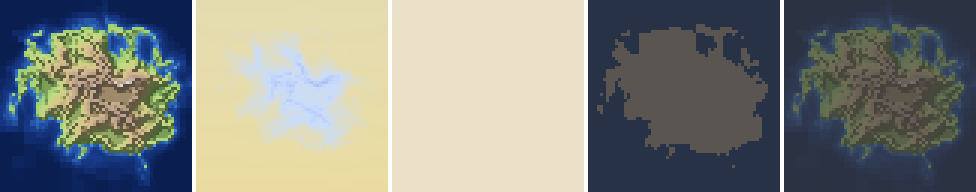
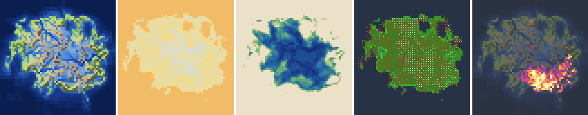
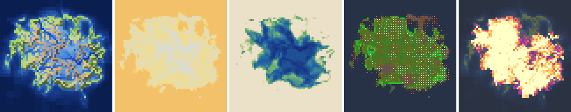
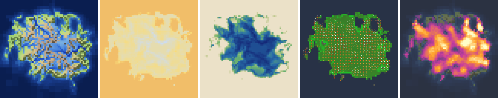

# M3 check point report

For the owner (spec 12.4 and 13.1). Numbers come from `series.csv` of two runs of the same seed. "Real" is the normal
run. "Null" is the control run (`--null`: learning off, spec 18.3). An item counts as emerged only where real beats null
clearly on the same columns.

## 1. What was run

Command: `ew run --size 64 --roster --years 300 --every 25 --frames-every 5 --pictures-every 50`, once as it is and
once with `--null`. Seed 1, an island of 2707 cells, 3 starting kinds of cover and the roster of animal kinds.
The real run starts with hand-set eater biases (the default start). The null run does not learn. So part of the gap
between the two runs comes from the start, not from learning.

**Speed.** 300 years took 170 s (real) and 155 s (null). That is 565 ms per year over the run and **672 ms per year
over the last 30 years** (null: 518 and 724). The settled speed is about 1.5 years per second. The target of 1,000
years in 10 minutes is 600 ms per year, so the run is about 12% too slow. Where the time goes (ms per year, years
200 to 300): bodies 442, flow 160, tape 41, change 24, parts 15.

**Books.** Element drift 1.3e-15 (real) and 1.9e-15 (null). Energy drift 1.7e-12 in both. Nothing was overdrawn.

## 2. Pictures

Each picture has five panels: map, temperature, rain, life, traffic (bright = many moves).

- Start (real and null are the same): 
- Real, year 100: all the traffic sits in one corner in the south-west. 
- Real, year 300: 
- Null, year 100: 
- Null, year 300: the traffic is spread over the whole island. 

**Lanes.** I built `web/` (it builds) and opened the real tape with the Paths button and the Worn layer. The island
shows no clear lanes, only a blur. There are only 25 to 59 worn edges on 2707 cells, so there is nothing to draw. I
added no picture of lanes. The traffic panel above is the best view.

## 3. Watch-for table (spec 13, M0 to M3)

Real and null are means of years 200 to 300 unless a year is named. "Cannot tell" means the run does not measure it.

| Item | Verdict | Evidence (real vs null) |
|---|---|---|
| M0 rain falls | appeared | `rain` 1.15e-3, `rain_land` 2.95e-3 mol/m2/s. Same in null (life does not make rain). |
| M0 rivers and lakes form | appeared | `rivers` 1129 land cells over the web threshold; `liquid_land` 1.5 km3. Same in null. Rivers are visible in the map panel. |
| M0 rivers carve valleys over centuries | cannot tell | No height column. The two maps (year 0 and 300) look the same at this size. |
| M0 climate bands | weak | `t_land_summer` 294.5 K, `t_land_winter` 280.6 K. One small island at one latitude, so no bands. |
| M0 deserts behind mountains | cannot tell | Not measured. The rain panel looks even. |
| M0 weaker sun gives more ice | cannot tell | Not run. `ice_frac` is 0 all the time. |
| M0 more absorbing gas gives a warmer world | cannot tell | Not run. `absorber` fell from 1.23 to 1.17 and `t_ground` from 287.7 to 287.2 K, the right direction but life is also moving. |
| M1 light-eaters spread | appeared | `cover_slots` 5473 and `cover_kg` 1.5e10 on 5473 slots. Null: 5168 slots and 2.0e10 kg. Cover is a founder, not a thing that emerged. |
| M1 eaters of eaters | did not | `eat_animals` 13 bodies of 8591 (null 62). `ate_others` is 0.15% of what is eaten (null 1.4%). Real is below null. |
| M1 kinds differ by climate | cannot tell | One climate on this island. No column by place and kind. |
| M1 populations rise, fall, cycle | appeared (boom and bust) | Kind 4: 1e8 members at year 100, 1.8e5 at year 200 (11 large turns). Not clean cycles. Null also moves (kind 7 and 9 turn 8 and 5 times). |
| M1 extinctions happen | appeared | Real: kind 8 dies at year 140, 6 kinds alive at 300. Null: 5 of 7 kinds die out, 2 alive. Real keeps more kinds. |
| M2 trails between visited places | appeared a little | `worn_edges` 39 vs 4.5 (9 times null), `worn_new` 6 a year. But only 1.4% of cells, `worn_persist` 0.19, and `traffic_top2` 0.33 vs 0.25 is close to chance. |
| M2 seasonal movement | cannot tell | No `months.csv` in this run. `inside_cold` and `inside_warm` do not decide it. |
| M2 imitation spreads learned behaviour | counts only | `watched` 1043 vs 109 a year, `watched_bodies` 591 vs 106, `spread_max` 3.6 vs 1.7, `learned` 0.23. Real beats null clearly, but a start with hand-set biases helps real, and the tape does not show a behaviour that spread. |
| M2 signals settle | cannot tell | No signal column in the tape. |
| M2 giving or exchange | did not | `gave` 802 a year at year 300 (null 3199); null is higher from year about 175. `gave_reciprocal` 28 vs 63. Real is higher before that (`gave` 579 vs 41 at year 50, 785 vs 380 at year 150). |
| M3 held objects used as tools | did not (cannot, by the laws) | `parts_held` 246 vs 722. A held part adds nothing to a body's force (`laws.md` 3.3), so no act can change. |
| M3 shelters used in cold times | weak, then reversed | Rooms appeared: `enclosed` 5160 vs 150, `inside_now` 75 vs 9 bodies. But the share of body-months inside is 0.5% in the cold and 1.3% in the warm. Cold use led only in years 50 to 100 (4.3% vs 1.9%). |
| M3 containers | appeared | `holding_liquid` 540 parts vs 101, `liquid_held` 9.7e4 kg vs 1.1e3 kg. |
| M3 floating structures | cannot tell | No afloat column. |
| M3 lasting structures (joined parts) | did not | `structures` 14 a year in years 50 to 100, then 1 to 2. `bonds_joined` 2 a year at year 300. Null: 2 to 6. |

## 4. The three biggest things that did not emerge

1. **Tools.** `laws.md` 3.3 says "a held part adds nothing to a body's force". Bodies hold 250 parts at a time, but
   no held part can change what an act achieves. Tools cannot appear by the laws as written. This is missing physics
   (spec 9.4), not a learning problem.
2. **Lasting structures and shelter used in the cold.** Rooms are built in the thousands (`enclosed`), but they are
   dropped as fast as they are made (`made_held` 4322 and `bonds_broken` 3276 a year at year 300). Bodies sit inside
   more in warm months than in cold ones late in the run. Best guess: perception and memory. Bodies see about 1
   cell (`sight` 1.0), remember 6 numbers (`memory`), and have nothing that links a cold month to a warm room. Rooms
   are an accident of making parts, not a thing that is found and kept.
3. **Learning that beats chance: gifts, lanes, signals, eating bodies.** Giving is below null late in the run, lanes
   cover about 1% of cells and last 19% of the time, and eating bodies is 0.15% of food. `learned` rises (0.23) but
   `greedy` is 0.94: brains almost always pick the top action, so they do not try new things. Only 6 brain lineages
   are alive (null 16). Best guess: learning (too little to try, too short a memory) and the food law (cover is much
   easier than bodies).

## 5. Key numbers

| | Real | Null |
|---|---|---|
| Settled speed (last 30 years) | 672 ms per year | 724 ms per year |
| Bodies at year 300 | 8459 (253 single, 8206 nodes) | 9009 |
| Members at year 300 | 4.1e7 | 5.3e6 |
| Kinds alive at year 300 | 6 | 2 |
| Brain lineages alive / ever | 6 / 35 | 16 / 662 |
| Element drift / energy drift | 1.3e-15 / 1.7e-12 | 1.9e-15 / 1.7e-12 |
| Births at year 300 | 4.7e7 a year | 2.9e6 a year |

Code size now: about 13,800 lines in `core/src` (two folder levels), 1,700 in `tape/src` and 2,000 in `worldgen/src`.

## 6. Decision

The owner chose to go on toward the zoomable world (`review/plan.md`, decision D1). Work package 2 (physics for tools,
so that a held part changes what an act achieves) comes first.
