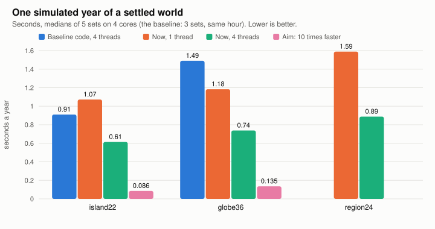
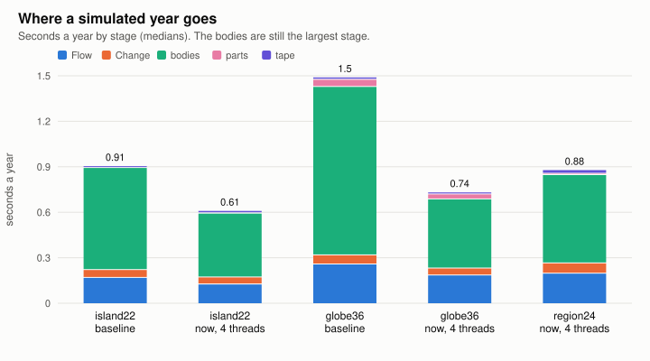
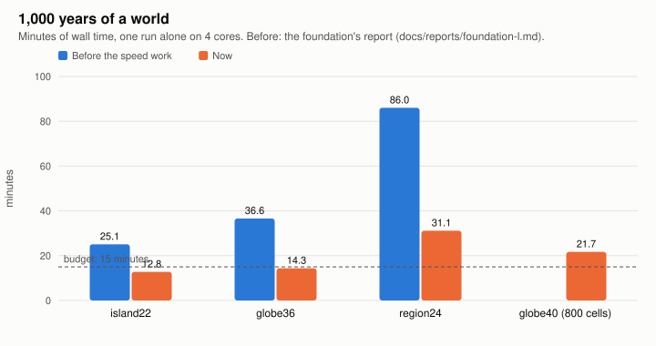
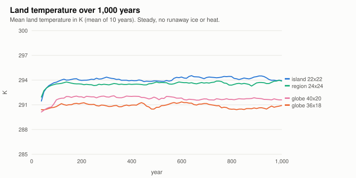
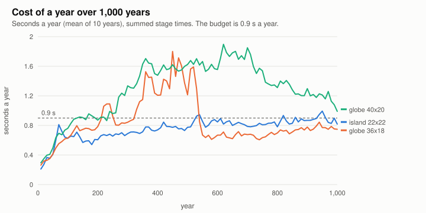
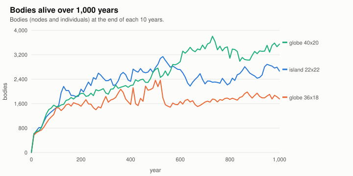
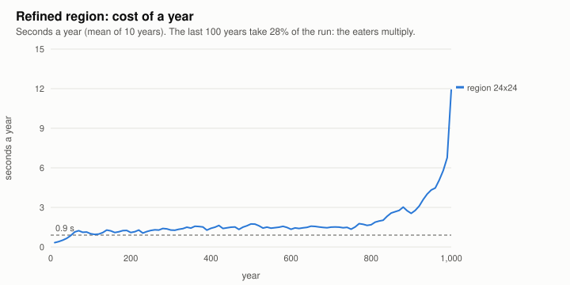
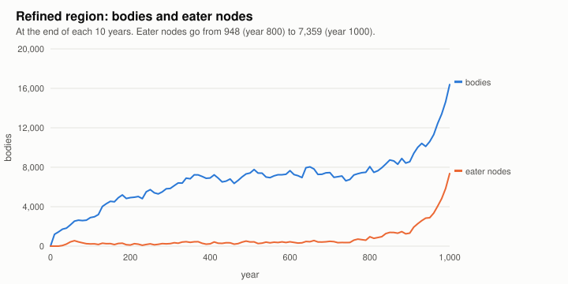

# Speed after the foundation: the final check

Watch report for the owner (handover 12.4; `docs/speed-post-foundation/plan.md`, Phase Z). Pictures are in
`docs/reports/speed/`. The numbers behind it are in `docs/speed-post-foundation/measures.md` (section Z and the rows),
the decisions in `decisions.md` (S1 to S84), and what changed and when in `docs/history.md`, section 5. The slow suite
(Z2) is not part of this report.

## In short

- **We did not reach 10 times.** A settled year is now 1.5 to 2 times faster than at the start (4 cores, the same hour):
  the 22 x 22 island 0.91 s to 0.61 s, the 36 x 18 globe 1.49 s to 0.74 s. The aim was 0.086 s and 0.135 s.
- **1,000 years are 2 to 2.8 times faster than before the speed work:** island 22 x 22 25.1 to 12.8 minutes, globe 36 x 18
  36.6 to 14.3 minutes, refined region 86 to 31.1 minutes. The aim for the globe was 3.7 minutes.
- **The largest planet that fits 15 minutes is the 36 x 18 globe: 648 cells** (before: about 290; the aim: about 2,900).
  The 40 x 20 globe (800 cells) takes 21.7 minutes. The 36 x 18 globe has little room: 14.3 of 15 minutes.
- **The books are exact and the world is the same kind of world.** In four runs of 1,000 years the worst element
  drift is 5.6e-16 and the worst energy drift 7.3e-14 (the limit is 1e-12); no heat was ever "not given". The land stays
  at 291 to 294 K for 1,000 years, with no runaway ice or heat.
- **Why not 10 times:** the part of a year that is not bodies (Flow, Change, parts, tape) alone is 194 ms on the island
  and 281 ms on the globe. The whole year of the aim is 86 and 135 ms. So even bodies that cost nothing would give
  only 4.7 and 5.3 times. The bodies became 1.9 to 2.2 times cheaper for one update on 4 cores, and four cores give the
  bodies only about 2 times, as a third of their time stays on one thread.
- **The two big ideas that cut the work did not pay** (fewer bodies, B; fewer updates, C): they were tried and not kept.
  The speed comes from the compiler (A), hot spots in the code (E2), and threads (D3, D2).
- **Open, and your choice:** seven items, on the last page of this report. The main ones: the world that makes many
  bodies in one cell (S66), the law question that C2 found, and the sleep bias that costs 20% to fix (S84).

## Where the speed stands

Seconds for one simulated year of a settled world, 4 cores (the medians of 5 sets; the baseline code was run in the
same hour on its own old saves):

| | island22 | globe36 | region24 |
|---|---|---|---|
| baseline code, 4 threads | 0.910 | 1.490 | |
| baseline as written in `measures.md` (another hour) | 0.857 | 1.347 | |
| now, 1 thread | 1.072 | 1.183 | 1.589 |
| now, 4 threads | **0.614** | **0.738** | **0.888** |
| faster than the baseline of the same hour | 1.48 | 2.02 | |
| the aim (10 times faster) | 0.086 | 0.135 | |

Read this with care: the benches were made again with the new code, so "now" is another world than "then" (S65). On
the island the new world has 17% more body updates a year (32,499 against 27,762), so its year looks worse than its
code is. A fairer number is the cost of one body update on 4 cores: island22 24.2 to 13.0 µs (1.86 times), globe36
43.4 to 20.0 µs (2.17 times). On one thread the new island is slower than the baseline (1.07 against 0.89 s), as the
domains, faces and outbox cost about 3% for each update and the world has more updates. The threads win it back.

Where a year goes (4 threads):

Bodies are still the largest stage (69%, 62% and 66% of a year; at the baseline 74% and 75%). Flow and Change are 29%,
32% and 30%.

**1,000 years** (one run at a time, nothing else on the machine; default pictures and snapshots every 10 years). The
"before" column is the foundation's report (`docs/reports/foundation-l.md`; its code was the foundation's final code).

| Run | Cells | Before | Now | Faster |
|---|---|---|---|---|
| island 22 x 22 | 484 | 25.1 min | 12.8 min | 1.97 |
| globe 36 x 18 | 648 | 36.6 min | 14.3 min | 2.55 |
| refined region, 24 x 24 with 8 x 8 split | 768 | 86 min | 31.1 min | 2.76 |
| globe 40 x 20 | 800 | | 21.7 min | |

The 1,000-year gain is bigger than the gain of one settled year. The "before" times come from another hour and from the
foundation's final code, and its island run ran beside another run, so this gain is less exact than the gain of a year.

**The largest planet in 15 minutes.** The foundation's model is: the time of a run is the cost of a cell and of a body
for a year, times their numbers (plan 5.7). Now a settled cell costs 1.1 to 1.3 ms a year on 4 cores (1.8 to 2.1 ms at
the baseline), so the model says about 710 to 790 cells fit 0.9 s a year. A real run of 1,000 years costs 15% to 23%
more than a settled year (the bodies grow over centuries, and some cells crowd), so about 650 to 690 cells fit. The
runs agree: the 36 x 18 globe (648 cells) fits, the 40 x 20 globe (800 cells) does not. A globe has an even number of
rows, so there is nothing between them. Straight between the two times, 15 minutes is at about 660 cells.

## The 1,000-year runs

Seed 1, `ew run --years 1000`. Everything ran to year 1,000.

| Run | Wall time | Bodies, year 100 / 500 / 1,000 | Most in one cell | Land K, year 100 to 1,000 | Gas, ppm | Worst element drift | Worst energy drift |
|---|---|---|---|---|---|---|---|
| island 22 x 22 | 12.8 min | 1,464 / 2,778 / 2,665 | 43 | 293.8 to 293.9 | 435 to 374 | 4.5e-16 | 2.7e-14 |
| globe 36 x 18 | 14.3 min | 1,462 / 2,365 / 1,755 | 623 | 290.8 to 291.0 | 372 to 352 | 5.2e-16 | 7.3e-14 |
| region 24 x 24 | 31.1 min | 2,896 / 7,418 / 16,386 | 231 | 293.6 to 293.8 | 439 to 411 | 4.1e-16 | 3.2e-14 |
| globe 40 x 20 | 21.7 min | 1,502 / 2,718 / 3,549 | 70 | 291.8 to 291.5 | 382 to 377 | 5.6e-16 | 7.1e-14 |

More climate and life numbers (ice, light-eaters, eaters, rain) are in `measures.md`, section Z3. The land
temperature is steady in all four runs:

How a year's cost moves over the run:

Two things in these runs are worth your eyes.

1. **Crowded cells (the foundation's open item).** On the 36 x 18 globe one cell held 623 bodies at year 410 and the
   year cost up to 1.8 s between years 340 and 540. The years that cost more than 1.25 times the median give about
   120 s of the 852 s. These are kinds of one lineage that differ in their genes and do not merge (S66).
2. **The refined region's eaters multiply at the end.** Eater nodes: 948 at year 800, 7,359 at year 1,000. The year
   1,000 has 16,386 bodies and 400,651 updates and costs 16 s. The last 100 years are 28% of the 31 minutes. We did not
   run beyond year 1,000, so we do not know where it stops.

## What each phase gave

Each gain is measured in its own step (`measures.md`); the percents are of the instructions or the time that step
named. The steps do not multiply into the 1.5 to 2 times of the year, as the benches were made again several times (S65).

| Phase | What it did | What it gave |
|---|---|---|
| A | The bench kit (A1); one code unit for the compiler (A2); many worlds at once (A3) | A2: the year 0.857 to 0.702 s (island) and 1.347 to 1.220 s (globe). A3: three runs side by side make 2.9 times more worlds a minute |
| E2.1 | Members of a node that stay in their cell act as the node, no clone for each part | the globe's bodies 4% faster (7% of their instructions) |
| E2.2 | Powers and exponentials in the body update kept once, cube root and square roots | 2.1% (island) and 1.4% (globe) of a year's instructions |
| D3 | The air's passes and Change's rows use all the threads (no least size of task; the main thread joins the pool) | Flow 1.23 and 1.22 times faster, the year about 8% |
| D2 | The world cut into domains; each runs its bodies on its own thread in 2-day batches; what leaves a domain waits in an outbox (D2.1 to D2.6, with the largest domain first and the survey on threads) | the bodies on 4 threads against 1: 2.10, 1.83 and 2.07 times; against the code before D2: 1.82, 1.79 and 1.98 times (aim 2.2, kill line 1.6). It cost about 3% an update on one thread |
| E2.3 | The repeated reads of an update; the booking once for each number; a fast path for taking from the store | 2.35% and 1.45%; 3.0% and 2.0%; 2.1% and 1.4% of a year's instructions (island, globe). The bodies' stage on 4 threads 5% faster for the booking |
| Room | Simplifications that made room for D1 (b); the tape written once at the end | 0.4% of instructions, and 100 lines fewer |

The core code went from 8,998 to 9,591 lines (the ceiling is 9,700; the aim of the plan was 9,500).

## What was tried and not kept

Each was built or measured, judged against its kill line, and taken out (or not built). The branches keep the code.

| Idea | What happened |
|---|---|
| B1 + B3: one node for each kind in a cell, its young inside it, two layers of light | Killed (S59). The island got more bodies (2,769 to 3,930; +49% instructions), the globe fewer (-15%); it needed -30% and -22.5%. Branch `speed/b1-b3-not-kept` |
| B2: a milder merge of unlike nodes | Not kept (S66). Bodies -15% and -20%, instructions -10% and -8%, but its test failed: `--crowd 8` and `merge_cap` x 2 moved the light-eaters by 7% and 9% against a noise of 5%. A speed setting must not make the world. Branch `speed/b2-rule-not-kept` |
| B2: one predicate for who may join whom | Not kept (S67). Bit for bit, but +1.4% and +0.4% instructions for 39 more lines. Branch `speed/b2-predicate-not-kept` |
| C2: nodes that update half as often | Not kept (S62). The pace test fails at 140 days (0 of 5 seeds), and the repair breaks the test around today's 36 days; the globe costs 45% more. Branch `speed/c2-not-kept`. The finding is in the open items |
| C1: dormant bodies rest | Not built (S63). Dry bodies are 3.4% and 5.5% of the updates; the gate was 5% on both |
| E1: columns | Not built (S82). A probe stored the bodies in the order they update: the bodies' stage was 7% to 15% slower on the island and -1% to +4% on the globe. Branch `speed/e1-probe` |
| E3: a stage-by-stage path for bodies without a brain | Not built (S76). Only about 3% of the instructions repeat; the gate was 10% |
| D1 (a): the tape's writing on a thread | Not built (S56). It is 0.5% of a year |
| D1 (b): the physics of the next step beside the bodies | Not built (S81). It needs 170 to 280 core lines (110 were free), changes more laws than planned, and could hide only 18.5% and 33.8% of a year |
| Scratch kept for each domain | Not kept. -1.6%, +3.1%, +3.9%: no gain above the noise |
| Booking in the task of a domain | Not built (S74). A probe was 6% slower (threads fight over cache lines); the safe design needs 30 lines for at most 4 to 6% of the bodies |
| The recorder on the pool | Not kept. 0.7% and 0.3% of a year; the kill line was 1%. Branch `speed/e23-tape-not-kept` |
| PGO again | Not kept. 1.1% and 3.8%; the bar was 8% (S35) |
| `nodes::add` in one pass | Not kept. 0.6% and 0.4% of instructions for 18 more lines. Branch `speed/e23-add-not-kept` |
| Compiler: fat LTO, `target-cpu=native`, `panic = "abort"` | Not kept (A2): under 2%, slower, and the tests need unwinding |

## Why not 10 times

The aim was a year of 86 ms on the island and 135 ms on the globe. The plan said at the start that 3 to 5 times was
more likely (S20). We got 1.5 to 2.

1. **The rest of a year is too big.** Flow, Change, parts and tape cost 194 ms (island) and 281 ms (globe) today, 2.3
   and 2.1 times the whole aim. Flow's air step is a solve of the whole air that runs mostly in ordered passes. D3
   made it 1.2 times faster; nothing else in the plan could make it much cheaper. With bodies for free, the island
   would be 4.7 times and the globe 5.3 times faster than the baseline.
2. **The serial share (Amdahl).** On 4 cores the bodies run 2.04, 1.87 and 2.10 times faster than on 1. About a third
   of their time stays on one thread: settling the world and applying the outboxes after each batch, the booking,
   the faces, and bodies that hold a part. The design's ceiling on 4 cores was measured at 2.45 to 2.74 after D2.6;
   the real gain is lower, as four threads at once make each domain's work 21% to 28% dearer (they share memory and
   cache). The whole year gains 1.75, 1.60 and 1.79 times from 4 cores. From the same shares, 8 cores would add only
   about 10% to 15%, and any number of cores no more than 2.0 to 2.4 times.
3. **The cost of an update.** One update is 115,000 to 185,000 instructions and 13 to 20 µs on 4 cores. The profile is
   flat: no function over 2.6% but the save. The body update loses about 22% of its cycles to cache misses, but a probe
   that put bodies in order of update did not help (E1), and PGO did not either.
4. **Fewer bodies and fewer updates did not work.** The plan counted on B and C for 2.5 to 3.5 times. B1, B2 and C2
   each failed on its own check (above): the bodies of a cell are set by the nodes that children start and by the
   many unlike nodes of one lineage, and nodes that update less often change the world's pace. Phases B and C gave no speed.
5. **Long runs get dearer.** Cells crowd and the region's eaters multiply; the mean year of a 1,000-year run is 15% to
   more than 100% over a settled year.

**What a newer CPU would give** (S5; not measured, arithmetic from the shares above): cores that are faster one by one
would help about as much as they are faster. More cores would add little (10% to 15% for 8 against 4).

**What group F would add.** Group F (S1) was not studied in this work, so no gain of it is measured. The plan (1.3)
names its ideas and what each would work on: *climate on repeat* and *slow stores sped up* would cut Flow and Change
(the 176 to 235 ms that nothing in A to E could cut); *life as a field* (common kinds as densities for each cell)
would cut the bodies further, and with it the crowded cells; *a GPU* would take Flow's per-cell work and Change's
reactors; *threads that may change the history* would put Flow's serial loops on all cores. The plan also names a
cheaper solve of the air and of the liquid (new physics algorithms). The plan's own count says the first two and the
solve are the ones that act on the part that stops 10 times.

## Open items for you

1. **S50, the stored share.** The light-eaters keep 0.55 of their mass as stored sugar; the key-number test says
   "under 0.5". It failed before the speed work and fails after it (0.552 to 0.558). It is a law change.
2. **S84, the sleep test.** The test `the_sleep_of_change_keeps_the_chemistry` fails on `air_3` (+5.8e-7 to +1.2e-6
   against a noise of 5.5e-7). It was there at the first commit of the sleep; it shows since the climate grew steadier.
   A fix is on the branch `sleep/pair-calm-proposal` (the test passes, the key numbers hold, golden re-pinned) but
   costs about 20% of a run. Merge it, or ask for a better span for a reaction pair that undoes itself.
3. **S83, the canopy check.** No land cell passes 20 kg/m² since the foundation's decision 63, so the check held no
   cell and failed. It now takes the densest 5% of the land cells with life, by rank. Please say if you want another rule.
4. **S49, the eaters' reference.** Their key number (mass at year 30) was set again to 5.354 (log10 kg), the mean of three
   seeds before E2.1, the range +/- 0.5 unchanged. The old reference 4.86 had not been set again after the final
   review's law changes.
5. **S66 (and S59): how many unlike nodes a cell holds is a world choice.** The milder merge cut the bodies by 15% to
   20% but moved the world, so a speed setting cannot be it. The crowded cells are the same thing: the crowded years
   cost the globe about 14% of its 14.3 minutes. If you want a rule for this, it is a law, with its own key numbers.
6. **The C2 finding.** A node's upkeep is paid from its stock before the interval's light comes in, and growth keeps a
   reserve of an interval's upkeep, so the stock grows with the interval (at 144 days adult deaths of unpaid upkeep are
   13 times as many). This is a splitting error of the laws, not a speed question. It is yours to rule on (branch `speed/c2-not-kept`).
7. **Phases B and C gave no speed**, and D2 reached 1.8 to 2.0 against its target of 2.2. If you want the 10 times, it
   needs group F or a new solve for the air; A to E are used up.

## Surprises

- The new island on one thread is slower than the baseline's.
- The baseline code hardly gains from 4 threads (0.91 to 0.89 s).
- The two globes round a few joules to zero in 1,000 years (3e5 J of 1e25); the foundation's globe rounded none. The
  counted amounts are tiny, and the drift is far under the limit.

## How the numbers were taken

- **Benches:** `scripts/bench.sh` with the three benches made again at `60a05eb` (snapshot version 47), five sets on
  4 threads and on 1 thread (`RAYON_NUM_THREADS=1`) interleaved, medians. The baseline code (`16e6a4e`) was built in a
  scratch folder and run on the old saves in the same hour, three sets.
- **Profiles:** `scripts/bench.sh profile` (callgrind, one year, one thread).
- **Long runs:** one `ew run` at a time on a quiet machine of 4 cores, with the default pictures, frames and
  snapshots, wall time of the process. "Before" is from `foundation-l.md` (another hour; its island ran beside another
  run).
- **Pictures:** made from the runs' `series.csv` and the bench lines by a small script kept outside the repository.
- **The machine drifts** by about 6% to 11% between hours; every comparison above is inside one hour or says so.
