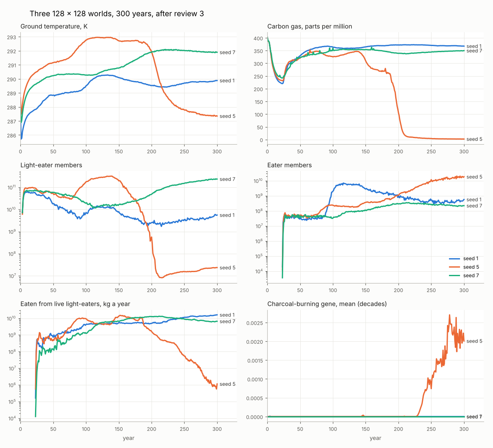

# Watch report 3: the third fix list before M4

14 October 2026. Code: `main` at 369e8af. Review that started this work: `review-3-before-m4.md`.
Full numbers: `watch-3-before-m4/analysis.md`.

## Short answer

We did all 16 items of review 3 (rows 0 to 15). The long runs then found three more bugs. We fixed
them and ran the three seeds again for 300 years at 128 x 128, plus null runs and roster runs at
64 x 64.

What changed in the world:

- **Genes no longer move without a reason.** In the old runs, plants carried genes for burning
  charcoal, copper and lime at 2 to 9 decades with nothing to select them. Now these genes stay at
  0 for 300 years in all three seeds. The plants' light gene goes *down* a little (11.9 to 11.1 in
  seed 7), because a catalyst now has a real price.
- **The carbon gas no longer crashes early.** It falls from 390 to about 230 parts per million in
  the first 20 years, then comes back to 350 to 370 (seeds 1 and 7). Before, it fell to 3 parts per
  million by year 20 and the plants starved.
- **Eaters now eat live plants.** By year 300, 60% (seed 1) and 28% (seed 7) of what eaters eat is
  live light-eaters, and in seed 1 16% is other eaters. Before, it was 87 to 100% dead matter on
  the ground. There is now a food chain with three steps: plants, eaters of plants and dead matter,
  and eaters of eaters.
- **A new story in seed 5: life took the carbon out of the air and cooled the world.** Tall
  light-eaters (their size gene at the top of its range) made a thick cover. Between years 150 and
  220 the cover and its dead matter took 99% of the carbon gas out of the air (350 to 2 parts per
  million), and the ground cooled from 293 to 287 K. Then the light-eaters starved. No climate rule
  did this. But part of it stands on a bug that is still open (see "Problems still open", point 1).
- **The greenhouse has no ceiling any more**, and charcoal no longer burns cold, so no seed warmed
  by burning charcoal this time. The warm-world story of watch report 2 is gone. That is honest:
  it stood on the gene drift and on charcoal that was too easy to burn.
- **Learning matters.** In the null runs (learning and imitation off), the eaters die out in two of
  three seeds. With learning they live in all three.
- **Giving and imitation are still chance.** Where eaters live in both runs (seed 7), the null run
  gives as often as the real run, and watches others *more* often.

What did not change: still only 2 to 3 kinds in the big runs (4 to 5 with the roster), no seasonal
travel, no shelters. Speed: 9 to 31 s per simulated year (watch 2: 17 to 24).

## What we built

| # | Review item | Done | What it gave |
|---|---|---|---|
| 0 | Buffer in front of the snapshot compressor | yes | A snapshot is written 3 to 4 times faster. Same bytes. |
| 1 | Node math moves no gene without selection | yes | Splits and children keep the mean exactly; spread capped at the split threshold; "off" range down to -6 for catalysts; catalyst step 0.3 decades; random pick among equal genes; a test with no selection (means stay within 0.1 step over 1,000 rounds). |
| 2 | Gifts bounded; copying as a process | yes | A gift is at most what the receiver could take by its size. A child store (`Body::paid`): a body pays for children over several updates. Copy cost 10⁷ J/kg (was 2 x 10⁶). |
| 3 | Merge only alike nodes | yes | Unlike kinds are kept apart in a cell, up to twice `crowd` (see bug 1 below). |
| 4 | Brain size can evolve in nodes | yes | A node whose mean size gene moved a whole unit moves to a new lineage, its brain carried over. |
| 5 | Catalysts cost by capacity; catalysts unfold when hot | yes | Cost = c x speed-up x bare rate at 290 K, one constant for all reactions. A new gene, DENATURE (320 K at the start): above it a catalyst stops working within a few K. In a 30-year 64 x 64 test the hottest body was 310 K (review 3 saw up to 974 K). |
| 6 | Greenhouse in layers | yes | 4 grey layers; more gas always warms more. A gas's absorption grows as the square root of its amount past a column amount (chemistry data). |
| 7 | Island latitudes match its size | yes | 31° to 33.3° (the review said 40° to 42.5°; we kept the same span but put it where the yearly sun equals the old mean, so the world is not 8 K colder). |
| 8 | Light passes bodies by height | yes | A tall member shades a short one. |
| 9 | Gases dissolve in standing liquid (Henry's law) | yes | The liquid holds about 4% of the air's carbon gas. That is right for plain dissolving; Earth's sea holds much more because of chemistry we do not have. |
| 10 | Copying when full is physics; a brain can shrink to zero | yes | A body past full copies whatever its brain does. A body with 0 hidden units takes no decisions and pays nothing for a brain. The cost of a decision now follows the size genes, so selection can lower them. |
| 11 | Kinds see diet; null run | yes | `kinds` uses the catalyst and uptake genes too, and `kinds_members` counts by members. `ew run --null`: no learning, no imitation, brain rows frozen. |
| 12 | Charcoal and the light reaction in chemistry 0 | yes | Charcoal burns with oxygen only above about 800 K (two reactions). The light reaction's speed is 10⁻⁶ (was 10⁻⁹), so the plants' gene is 12 (was 15). |
| 13 | A roster of ten starting kinds | yes | `ew run --roster`. Each kind prints its seeding line. The yearly series counts live members of each starting kind (`root_<k>_members`). |
| 14 | Cheaper body updates | yes | About 13% fewer instructions per body update. |
| 15 | Run again with null runs; write this report | yes | This file. |

Also from the review's smaller notes: the brain's cost per decision (not per day) is now written in
the handover as a speed incentive we keep on purpose; the sea's whole depth as one mixed layer is
written as a known limit.

### Bugs found by the long runs, all fixed

1. **Nodes doubled every update** (commit 967c2ac). Item 1 caps a node's spread just past the split
   threshold, and item 3 removed the rule that a full cell blocks a split. Together: a node at the
   cap split at every update, its halves were "unlike" and never merged back, and they split again.
   A 64 x 64 world reached about 146,000 bodies in one cell and ran out of memory at year 55. Now a
   node splits only while its cell has room (this no longer biases the genes, because the spread
   stops at the cap and a split keeps the mean). And a cell with more than twice `crowd` merges its
   most alike nodes, however unlike, as a safety limit.
2. **Giants of 17,000 tonnes** (9d0e958, a361eae). Single bodies inside structures took liquid and
   loose rock at a rate that grew with their own mass. Copying could not keep up. Now what a body
   takes, soaks up, catches of the rain and of light goes with its body (its mass up to `full` times
   its copy mass), not with what it holds.
3. **Children did not join their own kind** (ff58e33, 369e8af). With about 100 genes, a few children
   drawn from a varied node were almost always more than 4 steps away in at least one gene, so each
   group started a new node. Now children join a node if, in each gene, they are within 4 steps plus
   2 standard deviations of the node's spread. In the 64 x 64 roster run this cut the animal nodes
   from 14,400 to 2,500 and the time per year 3 times.

## Pictures

Each picture has five panels: map, temperature, rain, life (green plants, red animals), and traffic.

`watch-3-before-m4/chart.png`: the three big runs over 300 years. Top: ground temperature and carbon
gas. Middle: light-eaters and eaters (members, log scale). Bottom: what eaters eat from live
light-eaters, and the charcoal-burning gene (it stays near 0; the largest value is 0.003 decades).

- `seed1_year0300.png`, `seed7_year0300.png`: year 300 of seeds 1 and 7.
- `seed5_year0150.png`, `seed5_year0225.png`, `seed5_year0300.png`: seed 5 before, during and after
  the carbon gas fell. At year 300 the land is covered (life panel), and the light-eater members
  there are huge and mostly liquid.

## Key numbers

### The three big runs (128 x 128, 300 years, neutral eaters from year 22)

| | seed 1 | seed 5 | seed 7 |
|---|---|---|---|
| ground temperature, year 1 → 300 | 286 → 290 K | 287 → 287 K (peak 293 at year 120) | 287 → 292 K |
| carbon gas, lowest (year) → year 300, parts per million | 224 (20) → 368 | 2 (300) | 246 (20) → 350 |
| light-eater members, year 300 | 5.6 x 10⁹ | 2.4 x 10⁷ | 2.3 x 10¹¹ |
| eater members, year 300 | 5.7 x 10⁸ | 1.8 x 10¹⁰ | 2.2 x 10⁸ |
| what eaters eat at year 300: live plants / dead matter / other eaters | 60% / 24% / 16% | 0% / 100% / 0% | 28% / 71% / 1% |
| kinds (by bodies / by members), year 300 | 2 / 2 | 2 / 1 | 3 / 1 |
| charcoal gene, mean at year 300 (decades) | 0.0000004 | 0.002 | 0 |
| hidden units (mean), year 300 | 12.1 | 10.9 | 12 |
| bodies, year 300 | 21,811 | 25,882 | 12,638 |
| heaviest member, year 300 | 93 t | 621 t | 173 kg |
| seconds per simulated year, average (year 300) | 19.6 (28) | 31.2 (59) | 8.9 (12) |
| element drift / energy drift at year 300 | 3 x 10⁻¹⁵ / 9 x 10⁻¹⁴ | 3 x 10⁻¹⁵ / 4 x 10⁻¹³ | 3 x 10⁻¹⁵ / 1 x 10⁻¹³ |

The three runs ran at the same time with one more run on 4 cores, so the seconds are a little high.

**How much of the warming is life?** The same world with no life (seed 1, `--life-year -1`) warms
from 285.7 to 288.6 K in the first 100 years and then stays flat. The starting climate is not in
balance and needs about a century to settle (the sea counts as one deep layer). So in seed 1, life
added about 1.3 K at year 300. Seed 7 is another island; we did not run it without life.

### Compared with the last runs

| | watch 2 (seeds 1 / 5 / 7) | now |
|---|---|---|
| charcoal gene at year 300 | 7 to 16 decades | 0 to 0.002 |
| carbon gas at year 20, seed 1 | 3 parts per million (review 3 re-run) | 224 |
| greenhouse exponent at year 300 | 1.2 / 9.4 / 17.5 | 1.38 / 0.93 / 1.45 |
| eaters' food from live plants | 0 to 13% | 0 to 60% |
| heaviest member at year 300 | 11 t / 1,870 t / 132 t | 93 t / 621 t / 0.17 t |
| kinds | 1 to 3 | 2 to 3 (4 to 5 with the roster) |
| seconds per year | 17 to 24 | 9 to 31 |

### Null runs (64 x 64, 150 years; mean of years 101 to 150)

| | seed 1 real / null | seed 5 real / null | seed 7 real / null |
|---|---|---|---|
| eater members | 1.7 x 10⁹ / **0** | 1.0 x 10⁷ / **0** | 2.2 x 10⁷ / 1.5 x 10⁷ |
| gifts a year | 557 / 7 | 731 / 6 | 1,420 / 1,490 |
| watches a year | 2,270 / 6,180 | 5,620 / 4,180 | 2,070 / 3,360 |
| share of decisions that took the best-scored action | 0.93 / 0.30 | 0.61 / 0.20 | 0.81 / 0.36 |
| busiest 2% of cells, share of crossings | 0.21 / 0.28 | 0.36 / 0.41 | 0.31 / 0.30 |
| parts made and kept | 0.04 / 0 | 0.04 / 0.02 | 0.8 / 680 |

What this says:

- **Without learning, eaters die out** in seeds 1 and 5. So learning is what keeps them alive. That
  is the first watch-for item that clearly beats its null run.
- **Giving is chance.** Where both runs have eaters (seed 7), gifts are the same. In seeds 1 and 5
  the null run has fewer gifts only because it has no eaters.
- **Imitation is chance.** The null run watches others as often or more.
- **Trails are chance.** The busiest 2% of cells carry the same share of crossings with and without
  learning.
- **Seed 7's null run made 680 parts** and about 12 structures, the real run almost none. A neutral
  brain makes parts by chance; learning taught the real eaters to stop (it costs and gives nothing).

### Roster runs (64 x 64, 150 years, `--roster`)

| starting kind | seed 1, year 150 | seed 5, year 150 |
|---|---|---|
| light-eaters | 2 x 10⁶ | 1.2 x 10⁸ |
| small fast light-eaters | 2.5 x 10⁸ | died (year 25) |
| big slow light-eaters | died (year 100) | died (year 150) |
| small eaters of remains | 2.8 x 10⁸ | 3.6 x 10⁹ |
| big eaters of remains | 6.9 x 10⁹ | died (year 30) |
| small fast eaters of light-eaters | died (year 30) | 3.3 x 10⁷ |
| eaters | 1.2 x 10¹⁰ | 2.1 x 10⁹ |
| big slow eaters of light-eaters | died (year 30) | died (year 100) |
| strong fast eaters of eaters | 2.6 x 10⁹ | 1.1 x 10⁷ |
| strong big slow eaters of eaters | died (year 30) | not seen |
| kinds (by bodies / by members) | 4 / 2 | 5 / 3 |

Six of ten kinds live to year 150 in seed 1, five in seed 5. The same seeds started from two kinds
have 3 / 2 and 2 / 1 kinds. So the roster gives more kinds that stay apart, and every placed rung of
the food chain except the biggest slow ones survives in one seed or the other. The big slow animals
die in the first months: a neutral brain does not find food in time when it decides rarely.

## What emerged, and what did not

| Watch-for | Now | Notes |
|---|---|---|
| Rivers, lakes, valleys | yes | as before |
| Climate bands | weak | now from height and sea only (the island spans 2.3° of latitude) |
| More heat-absorbing gas → warmer | yes, no ceiling now | seed 5 shows the other way: less gas, 6 K colder |
| Life changes the climate | yes (seed 5) | by taking carbon gas out of the air, not by burning |
| Light-eaters spread where conditions fit | yes | |
| Eaters of eaters | yes | 16% of eaters' food in seed 1; a roster kind lives on it |
| Food chain | yes | plants, plant-eaters and dead-matter eaters, eaters of eaters |
| Kinds differ by climate | not seen | catalysts are nearly free for eaters (see open point 4) |
| Populations rise, fall, cycle; extinctions | yes | roster kinds die out; seed 5's plant crash |
| Taller light-eaters | yes, too far | size gene at the top of its range, see open point 1 |
| Trails | chance | same as the null run |
| Seasonal movement | no | |
| Imitation spreads behaviour | chance | the null run watches as much |
| First giving | chance | same as the null run |
| Tools, shelters, containers | no | seed 7's null run makes more parts than the real one |
| Brains shrink where they are not needed | a start | seed 5: 12 → 10.9 hidden units |

## Problems still open

1. **Members of many tonnes, mostly liquid.** Light-eaters (and some others) evolve a copy size near
   the top of the gene's range (about 10 t; light by height pays for size). Then they cannot pay
   for a child: a child costs 10⁷ J per kg, even for the 90% of it that is liquid. So they swell to
   5 to 30 times their copy size with liquid and never copy (93 t in seed 1, 621 t in seed 5). This
   helped seed 5 lock its carbon in the cover. **Proposal:** the copy cost counts only what the
   child is built of, not the liquid it carries (moving liquid costs nothing; making tissue does).
   It is a small change in `copy::copy`. Also check whether the copy-mass range (up to 10⁴ kg)
   should be wider, so the wall is not what stops size.
2. **Big worlds are crowded with nodes.** Unlike variants now stay apart up to twice `crowd` per
   cell (8). In seed 5 at year 300 this is 25,882 bodies and 59 s per year. M4's coarse regions are
   the planned answer. Until then, `--crowd 3` is a cheap way to run faster.
3. **Bodies inside structures stay single.** A node cannot hold or be inside, so each such body is
   its own node (the known limit of handover 6.3). Up to 1,150 in one cell in an old run. M4's first
   job ("parts held by nodes") is the answer.
4. **Catalysts are nearly free for eaters.** The cost by capacity was set so the starting plants pay
   what they paid before. Then the eaters' burn gene costs a few J per kg per day against 60,000 for
   strength. So cold tolerance still has no real price, and no kinds by climate appear. **This is a
   choice for the owner:** a higher `c_cat` (for example set by what the plants need, about gene 9,
   not what they had) would give catalysts a price for everyone.
5. **Nothing dies of age** (review 3, W2). Still a decision for the owner.
6. **A node pays for its mean gene.** Members around the mean would pay more on average (the cost is
   exponential in the gene: about 4 times at the capped spread). The catalysed rate has the same
   bias, so the two cancel in part. Note for the M4 check (nodes against individuals).
7. **Brainless plants are slow to evolve.** The hidden-units gene must walk from 12 to 0, about 600
   generations. Only seed 5 started (12 → 10.9). It may take the whole of the next long run.
8. **The starting climate needs a century to settle** (+3 K with no life). Reports should compare
   with the no-life run, as we did here.

## What next

The four big findings of review 3 (gene drift, the greenhouse ceiling, the carbon-starved ecology,
free catalysts) are fixed in the code, with numbers above. Two things are left that change what the
results mean: the liquid giants (open point 1, a small fix) and the catalyst price (open point 4, a
decision). We suggest:

1. Fix open point 1 and decide open point 4, then run seed 5 again for 300 years to see if the
   carbon story stands without the giants.
2. Then go to M4, with its first job as planned: parts held by nodes, then coarse regions.

Code size: `core` is 6,977 lines (budget 8,000 through M7), `worldgen` 876.
