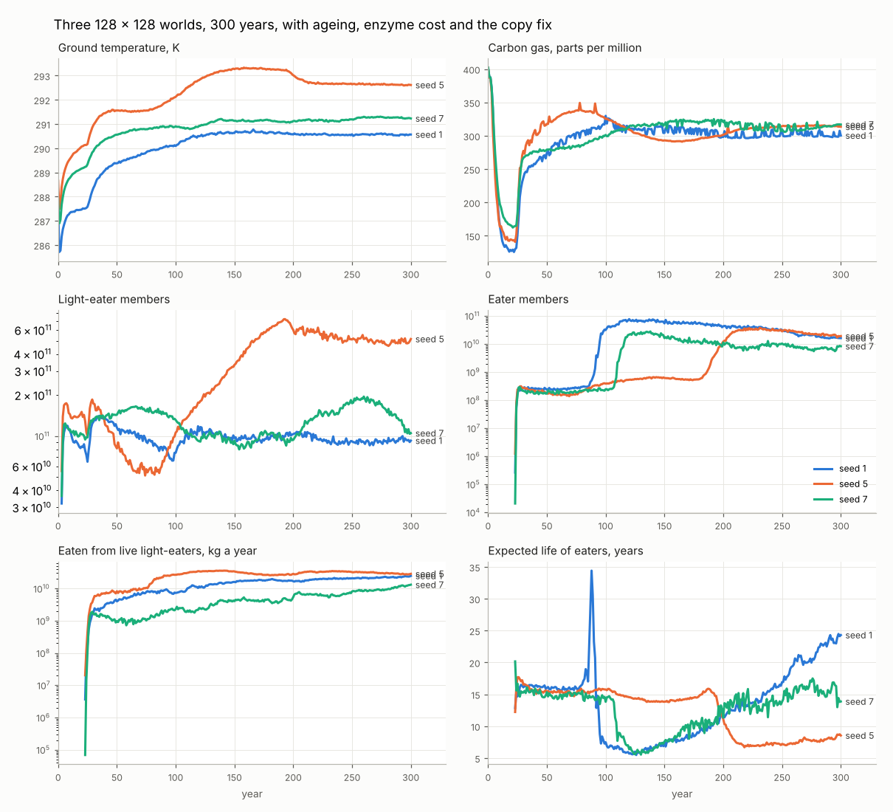

# Watch report 4: ageing, the enzyme cost and the copy fix

14 October 2026. Code: `main` at 444dabf. Before this: `watch-3-before-m4.md`. Full numbers:
`watch-4-before-m4/analysis.md`.

## Short answer

The owner asked for three changes after watch report 3. All three are built, and we ran the three
seeds again for 300 years at 128 x 128, with null runs and roster runs at 64 x 64.

1. **A child costs what it is built of, not the liquid it carries.** The liquid giants of report 3
   (93 t and 621 t members that never copied) are gone. The size gene can now reach 1,000 t.
2. **Bodies die of age.** Living wears a body out. A small fast body wears out quickly, a big slow
   one lives long, and a repair gene lets evolution choose a longer or shorter life at a cost.
3. **Enzymes cost what they cost in life.** An eater's digestion enzymes now cost about a tenth of
   its upkeep (before: 0.01%). Plants start with the light enzyme they need (9, not 12).

What changed in the world:

- **All three worlds are stable and alike.** The carbon gas ends at 300 to 317 parts per million in
  all three seeds, the ground at 291 to 293 K. Seed 5 no longer loses its carbon gas: last time's
  "cover that took the carbon out of the air" stood on the liquid giants.
- **Many more eaters.** 8 x 10⁹ to 2 x 10¹⁰ eater members at year 300 in every seed (report 3:
  2 x 10⁸ to 2 x 10¹⁰). A third to a half of their food is live plants.
- **Age is a small share of deaths** (1 to 2%): most bodies still starve or are eaten first. But
  evolution uses the repair gene: lives change over time, and in the roster runs most animals
  evolved *shorter* lives (cheaper upkeep), from about 18 years to 1 to 2 years.
- **Learning still matters, giving and imitation are still chance** (null runs, as in report 3).

## What we built

| # | Change | What it does |
|---|---|---|
| 1 | Copy cost of what a child is built of | The work of making a child, 10⁷ J per kg, counts only what is not liquid at the body's temperature: moving liquid is not building. The copy-mass gene's range goes up to 10⁶ kg (selection for height had pushed it to the old wall of 10⁴). |
| 2 | Ageing by the rate of living | A body's wear grows with the energy its upkeep uses per kg. It dies of age when it has used 10⁹ J per kg × 10^(repair gene). 10⁹ J per kg is the real "rate of living" number: many animals use about that much in a life, whatever their size. A node loses a matching share of its members at each update. |
| 2 | Repair gene | Repair is a quarter of upkeep at gene 0 and doubles with each unit of the gene. At the start, 25% more upkeep buys an 8 times longer life; less repair saves upkeep, but never more than that quarter. |
| 2 | Lives of the starting kinds | Set by their repair genes (a starting choice, like the roster): about 2 years for the smallest fast ones, 18 for light-eaters and eaters, 34 to 97 for the big slow ones. Evolution changes them from there. |
| 3 | Enzyme cost | `c_cat` 1.5 x 10⁹ (was 1.67 x 10⁶). An eater's enzymes cost 6,200 J per kg per day, a tenth of its upkeep, as in life (10 to 25%). Living 9 K colder costs an eater 14% more upkeep (before: nothing). |
| 3 | Plants' light enzyme | Starts at 9 (was 12): what they need. They pay what they paid before (3,100 J per kg per day). Roster eaters start with the eaters' enzyme (2.6, was 3.0 to 3.2). |

The series has new columns: `died_age` and `a_age` (deaths by age), and per starting kind
`root_<k>_life` (expected life in years) and `root_<k>_repair` (mean repair gene).

## Pictures

Each picture has five panels: map, temperature, rain, life (green plants, red animals), and traffic.

`watch-4-before-m4/chart.png`: the three big runs. Top: ground temperature and carbon gas. Middle:
light-eaters and eaters (members, log scale). Bottom: what eaters eat from live light-eaters, and
the eaters' expected life (years).

- `seed1_year0300.png`, `seed5_year0300.png`, `seed7_year0300.png`: year 300 of each seed.
- `roster_seed5_year0150.png`: the roster run of seed 5 at year 150.

## Key numbers

### The three big runs (128 x 128, 300 years)

| | seed 1 | seed 5 | seed 7 |
|---|---|---|---|
| ground temperature, year 300 | 290.6 K | 292.6 K | 291.2 K |
| carbon gas: lowest (year) → year 300, parts per million | 126 (22) → 300 | 141 (23) → 314 | 162 (21) → 317 |
| light-eater members, year 300 | 9.3 x 10¹⁰ | 5.2 x 10¹¹ | 1.1 x 10¹¹ |
| eater members, year 300 | 1.6 x 10¹⁰ | 1.9 x 10¹⁰ | 8.3 x 10⁹ |
| what eaters eat: live plants / dead matter / other eaters | 32% / 63% / 4% | 54% / 42% / 4% | 33% / 67% / 0% |
| deaths by age, share of all deaths | 0.8% | 2.1% | 1.0% |
| expected life at year 300: light-eaters / eaters (years) | 13 / 24 | 5 / 8.5 | 14 / 14 |
| mean repair gene at year 300: light-eaters / eaters (start: -1.0 / -0.4) | -1.03 / -0.52 | -1.23 / -0.55 | -1.04 / -0.77 |
| kinds (by bodies / by members), year 300 | 2 / 2 | 2 / 2 | 3 / 2 |
| heaviest member, year 300 | 34 t | 27 t | 26 t |
| bodies, year 300 | 21,451 | 14,460 | 16,243 |
| seconds per simulated year, average | 27.4 | 15.9 | 21.7 |
| element / energy drift, year 300 | 8 x 10⁻¹⁵ / 1.5 x 10⁻¹³ | 4 x 10⁻¹⁵ / 1.5 x 10⁻¹³ | 1 x 10⁻¹⁴ / 1.4 x 10⁻¹³ |

The three ran at the same time with the small runs on the fourth core, so the seconds are high.

### Compared with report 3

| | report 3 (seeds 1 / 5 / 7) | now |
|---|---|---|
| carbon gas at year 300 | 368 / 2 / 350 | 300 / 314 / 317 |
| ground temperature at year 300 | 289.9 / 287.4 / 291.9 | 290.6 / 292.6 / 291.2 |
| eater members at year 300 | 5.7 x 10⁸ / 1.8 x 10¹⁰ / 2.2 x 10⁸ | 1.6 x 10¹⁰ / 1.9 x 10¹⁰ / 8.3 x 10⁹ |
| eaters' food from live plants | 60% / 0% / 28% | 32% / 54% / 33% |
| heaviest member at year 300 | 93 t / 621 t / 0.17 t | 34 t / 27 t / 26 t |
| what the heaviest are | light-eaters 15 to 30 times past their copy size, 95% liquid, never copying | eaters with a copy size of 9 to 15 t, at about twice that size |

### Null runs (64 x 64, 150 years; mean of years 101 to 150)

| | seed 1 real / null | seed 5 real / null | seed 7 real / null |
|---|---|---|---|
| eater members | 5.9 x 10⁹ / **0** | 8.7 x 10⁷ / **0** | 9.6 x 10⁸ / 5.0 x 10⁷ |
| gifts a year | 183 / 9 | 101 / 3 | 1,730 / 199 |
| watches a year | 2,300 / 2,630 | 1,860 / 2,640 | 1,280 / 4,630 |
| busiest 2% of cells, share of crossings | 0.18 / 0.27 | 0.29 / 0.29 | 0.40 / 0.32 |
| share of decisions that took the best-scored action | 0.93 / 0.17 | 0.90 / 0.15 | 0.86 / 0.59 |

- **Without learning, eaters die out** in seeds 1 and 5, as in report 3, and in seed 7 they are 19
  times fewer.
- **Giving and imitation are still chance.** In seed 7, per eater, the null run gives about twice as
  often and watches others 70 times as often as the real run.
- **Trails:** seed 7's busiest cells carry a little more of the traffic with learning (0.40 against
  0.32); seeds 1 and 5 do not. Too weak to call a result.

### Roster runs (64 x 64, 150 years)

| starting kind | seed 1: alive at year 150? (life then) | seed 5 |
|---|---|---|
| light-eaters (1 kg) | died (year 50) | yes (35 years) |
| small fast light-eaters | died (year 46) | died (year 10) |
| big slow light-eaters | yes (7 years) | yes (14 years) |
| small eaters of remains | yes (1.2 years) | yes (1.8 years) |
| big eaters of remains | yes (1.1 years) | yes (2.0 years) |
| small fast eaters of light-eaters | died (year 30) | died (year 109) |
| eaters | yes (0.9 years) | yes (2.0 years) |
| big slow eaters of light-eaters | died (year 48) | died (year 25) |
| strong fast eaters of eaters | died (year 29) | died (year 69) |
| strong big slow eaters of eaters | died (year 29) | yes (2.2 years) |

Four kinds live to year 150 in seed 1, six in seed 5 (report 3: six and five). Most animals evolved
much shorter lives than they were placed with (eaters: from 18 to 22 years down to 1 to 2). A short
life with less repair saves upkeep, and in a crowded world where few die of age anyway, that pays.

## What emerged, and what did not

| Watch-for | Now | Notes |
|---|---|---|
| Food chain | yes | plants, plant-eaters and dead-matter eaters, a little predation (up to 4%) |
| Lifespans that differ by kind and evolve | yes | the repair gene moves; roster animals evolved short lives |
| Populations rise and fall; extinctions | yes | eaters grow 70 to 250 times between years 90 and 200, then fall back by half or more; roster kinds die out |
| Life changes the climate | no | carbon gas and temperature settle alike in all three seeds |
| Kinds differ by climate | not seen | the enzyme cost is now real, but the island spans only 7 to 10 K over most of its land |
| Brains shrink where not needed | no | hidden units stay 11.9 to 12 |
| Trails, giving, imitation | chance | see the null runs |
| Tools, shelters | no | |

## Problems still open

1. **Big eaters of 9 to 15 t sit at twice their copy size** with little fuel (90% liquid). They are
   bounded now (before, giants reached 30 times), but they barely copy. Watch it in the next runs.
2. **The world is slower:** 16 to 27 s per simulated year on average (report 3: 9 to 31), because
   there are more eaters (more nodes). M4's coarse regions are the planned answer.
3. **Kinds by climate need climate.** The island is 256 km across; real climate bands come with
   the planet (M4).
4. **The kinds measure is noisy:** the roster run of seed 5 has six starting kinds alive at year 150,
   but the measure counts one.
5. From report 3, still open: bodies inside structures stay single (M4's "parts held by nodes"); a
   node pays for its mean gene; the starting climate takes about a century to settle.

## What next

Review 3's list is done, and the owner's three changes are built and checked over 300 years in three
seeds. Nothing left here changes what the results mean the way gene drift or free enzymes did. We
think the project can go to M4, with its first jobs as planned: parts held by nodes, then coarse
regions and a planet with real climate bands.

Code size: `core` is 7,029 lines (budget 8,000 through M7).
