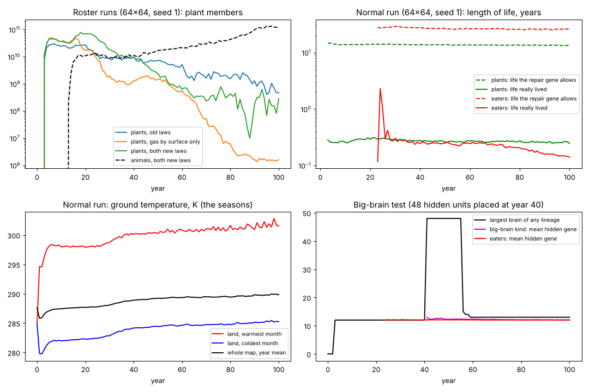

# Watch report 5: review 4's list done

14 October 2026. Code: `main` after review 4 (`review-4-before-m4.md`). Pictures and chart in
`watch-5-before-m4/`. All runs here are 64 x 64, seed 1, 100 years, so they are short checks, not
the big 300-year runs of report 4.

## Short answer

All seven rows of review 4's list are done (row 8 is M4 itself).

1. **Brain size can now change inside a population node.** A node can split along its brain-size
   genes, so selection can act on them. A test shows it works. But in 100-year runs the brain size
   did not move yet (11.7 to 12.4): nodes split in two only rarely, and a split moves one gene at a
   time.
2. **The series now shows each starting kind on its own:** its deaths by cause, its births, the
   life it really lives, its mass and its genes. It also shows the seasons on land.
3. **Report 4's gene story is corrected.** The plants' light gene never fell. It is still 9.0.
4. **Bodies breathe through their surface,** not by their mass. Plants grew more leaf (capture area
   about 4 m² per kg instead of 2) and breathe more carbon gas. No tall plants yet in the normal run.
5. **The big-brain test cannot answer its question.** Ordinary eaters' children joined the
   big-brain nodes within one year and averaged their brain gene from 48 down to about 12.
6. **Speed:** three small gains that keep every result the same, and threads as an option (6.5%
   faster at 128 x 128). One idea was dropped because it would change results.
7. **What a body takes in now grows with mass^0.75,** not with mass. So size is no longer free.

Two things we learned that matter for M4:

- **Lives are short, and the new columns prove it.** Plants live about 90 days, and the 1 kg
  plants' repair gene would allow 13.5 years. Eaters live about 50 days, and their gene would
  allow 26 years. Most die of hunger.
- **The roster world goes wrong over 100 years, with the old laws too.** The plants fall from
  about 4 x 10¹⁰ members to a few 10⁸. Tiny eaters of remains (0.02 to 0.1 kg) take over, and some
  members reach thousands of tonnes. The new laws did not cause this: the same run with the old
  laws does the same.

## What we built

| Row | Change | Where |
|---|---|---|
| 1 | A node's split now counts the brain-size genes in their own steps. Likeness (for merging) still leaves them out. So a node splits along a brain size now and then, and the monthly merge joins the halves again, with the mean moved toward the half that grew. | `copy::split` |
| 2 | New columns per starting kind `k`: `root_<k>_died_<cause>`, `root_<k>_births`, `root_<k>_life_real` (members over deaths a year), `root_<k>_mass`, `root_<k>_copy_mass`, the genes `_gas`, `_leaf`, `_copy_log`, `_interval`, `_hidden`, and the catalysts `_cat_<r>` (the mean over members whose gene is on) with `_cat_<r>_on` (the share of members whose gene is on). Seasons: `t_land_summer`, `t_land_winter`, `t_land_swing`. The `kinds` measure is now called a floor (it cannot count past 6). | `tape` |
| 3 | A correction at the top of report 4, and a note in report 3. | reports |
| 4 | Gas exchange through the open surface: capture area plus skin, 6 (m/ρ)^(2/3) per member. The gas gene is now per m². Each starting kind's gas gene is reset so that it breathes at the start what it breathed before. For example, the 1 kg plant goes from 2.5 to 2.19 and the 30 kg eater from 0.6 to 2.29. | `body::live`, `body::plan`, `worldgen::life` |
| 5 | The big-brain run (`--clever-year 40`), done next to the normal run. | run |
| 6 | Less memory work in hot paths. A node's member that splits off for a Bond action and comes straight back no longer copies its brain rows. Threads for radiation, wind and the air reactions (`--features threads`). | `body`, `copy`, `flow`, `change`, `core/src/par.rs` |
| 7 | What a member takes, sweeps and receives grows with (its mass)^0.75. At 1 kg it takes as before. A 30 kg eater takes 2.3 times less per kg, and a 10 t member 180 times what a 10 kg one takes, not 1,000 times. Light, rain, liquid and gas go by area. | `Body::intake` |
| also | The two big slow roster eaters (150 kg and 600 kg) start with 60% of their mass as fuel, not 30%. Before, they starved before their brain had decided a few times. The seeding line prints it. | `worldgen::life` |

## Pictures

`watch-5-before-m4/chart.png`:

- **Top left:** plant members in the roster run with the old laws, with only the gas law, and with
  both new laws, and the animals with both new laws. All three runs lose their plants.
- **Top right:** for the normal run, the life the repair gene allows (dashed) against the life really
  lived (solid). The lived life is 50 to 100 times shorter.
- **Bottom left:** the seasons on land. About 16 K between the warmest and the coldest month.
- **Bottom right:** the big-brain test. The kind keeps its 48-unit brain only as a name. Its brain
  gene is about 12 from the first year.

Maps (map, temperature, rain, life, traffic): `seed1_year0100.png` (normal run),
`roster_seed1_year0100.png` and `roster_old_laws_seed1_year0100.png` (roster, new and old laws).

## Key numbers

### The normal run, year 100 (64 x 64, seed 1)

| | plants (kind 0) | eaters (kind 1) |
|---|---|---|
| members | 3.9 x 10¹⁰ | 8.7 x 10⁷ |
| mean member mass | 1.5 kg | 57 kg |
| life the repair gene allows | 13.5 years | 26 years |
| **life really lived** | **0.25 years (90 days)** | **0.14 years (51 days)** |
| deaths a year: spent (no fuel) / lack (a key store too low) / eaten / age | 1.1 x 10¹¹ / 6.4 x 10¹⁰ / 4 x 10⁷ / 3.6 x 10⁹ | 8.3 x 10⁸ / 1.9 x 10⁷ / 392 / 4.3 x 10⁶ |
| light gene (members whose gene is on) | 9.03 | off |
| burn gene | 2.09 | 2.67 |
| gas gene (per m², starts at 2.19 and 2.29) | 2.36 | 2.38 |
| leaf gene (capture area, log10 m² per kg; starts at 0.3) | 0.61 | -2.77 |
| hidden-units gene | 12.0 | 12.0 |

Whole world at year 100: ground 289.8 K; carbon gas 195 parts per million; land 301.6 K in the
warmest month and 285.3 K in the coldest (a swing of 16.3 K); 2,427 bodies; heaviest member 135 kg.
Element and energy drift stay at about 10⁻¹⁶ and 10⁻¹⁴.

### Before and after the two laws (seed 1, 64 x 64, year 60)

| | old laws | gas by surface only | both new laws |
|---|---|---|---|
| plant members | 7.7 x 10¹⁰ | 3.2 x 10¹⁰ | 3.7 x 10¹⁰ |
| plants: capture area per member | 2.0 m² | 6.7 m² | 6.7 m² |
| plants: mean / heaviest member | 1.2 / 4.3 kg | 1.7 / 12 kg | 1.7 / 28 kg |
| eater members | 9.3 x 10⁷ | 1.4 x 10⁸ | 7.0 x 10⁷ |
| eaters: mean / heaviest member | 65 / 308 kg | 50 / 205 kg | 58 / 189 kg |
| carbon gas | 233 ppm | 241 ppm | 180 ppm |
| ground temperature | 289.8 K | 290.1 K | 289.5 K |
| seconds per year | 2.16 | | 2.24 |

What this says:

- Plants now spread more leaf: it pays twice (for light and for gas). Their members are a little
  heavier, but there is no forest. The heaviest plant is 28 kg.
- The plants take more carbon gas out of the air. It is lower (180 to 195 ppm against 233), but
  steady. Watch it in the 300-year runs.
- 60 to 100 years is too short to see the copy-mass wall that review 4 worried about: the 9 to
  15 t eaters of report 4 came from 300-year runs. The real test of row 7 is a 300-year run.

### The roster over 100 years: an old problem

| year 100 | old laws | gas by surface only | both new laws |
|---|---|---|---|
| plant members | 4.7 x 10⁸ | 1.6 x 10⁶ | 2.9 x 10⁸ |
| plant kinds alive (of 3) | 1 (the 20 kg ones) | 1 (the 1 kg ones) | 1 (the 20 kg ones) |
| mean mass of the plants left | 142 kg | | 115 kg |
| animal members | 3.9 x 10¹⁰ | 5.8 x 10¹⁰ | 1.2 x 10¹¹ |
| small eaters of remains: copy mass (starts at 1 kg) | 0.023 kg | 0.029 kg | 0.09 kg |
| heaviest member | 5,400 t | 760 t | 3,400 t |

With every set of laws, the roster world loses most of its plants by year 60 to 100. Small eaters
of remains shrink to tens of grams and become most of the members, and a few giant members appear.
With both new laws it is about as bad as with the old laws. The eaters of remains shrink later (they
are still 2.3 kg at year 55), and the plants that are left are big (115 kg). With the gas law
alone it is worse: the plants almost vanish. That is why both laws go together.

We do not know yet why the roster loses its plants, or what the giant members are. Report 4 ran
the roster only to count which kinds survive. This is the first time we look at its plants. It is
the first thing to look at in the next roster runs. The new per-kind columns can now show it.

### The big-brain test (row 5)

404 eaters with a 48-unit brain (12 memory slots, 6 bodies seen, sight 3) were placed at year 40,
next to the ordinary eaters (12 units). One year later their kind had 4,465 members in 88 bodies,
with a mean hidden-units gene of 12.9. Two years later it had 1.3 million members. The ordinary
eaters' children had joined their nodes. A child joins the first node it is like, and likeness
leaves the brain sizes out (handover 7.1). So the kind's brain gene was averaged down to the
ordinary eaters' 12. The 48-unit lineage was left as a name until year 55, when its nodes moved
to lineages of 12 to 15 units.

So the test **cannot tell whether a big brain pays**. The big brain was not selected away. It was
diluted. A fair test needs the big-brain kind kept apart, for example children that join only nodes
of their own brain size, or the kind placed alone. Changing how children join is a change to how
nodes work, so it is the owner's choice. We did not make it.

### Brain size in nodes (row 1)

The test: members that live 5% less per hidden unit (as if they paid for a brain they do not use)
move a node's hidden gene from 12 to 10.9 in 1,000 updates, and the nodes then move to an 11-unit
lineage. With no selection the gene stays put.

In the runs: the hidden gene is still 12.0 in the normal run, and 11.7 over all members in the
roster run (12.2 to 12.4 per kind). Two reasons. First, a node splits in two only when its members
differ a lot, and in a 64 x 64 world that is rare (2 to 3 splits in two in the first 40 years). Second,
a split moves one gene of the many at a time: selection inside a node is about 3% as fast as if
the whole spread were open to it. The plants' brainless future (review 3, Q2) is possible now, but
it will be slow. We will see in 300-year runs whether it starts.

### Speed (row 6)

Every change below keeps the run's hash the same: the same world, bit for bit.

| Change | Gain |
|---|---|
| Less memory work (`thin`, `starve`, `copy::part`) | 0.06% of the instructions; memory work was under 2% of a run |
| A member that splits off for a Bond action and comes straight back: no copies of the brain rows | 0.44% (35,000 instructions per round trip) |
| Threads for radiation, wind and the air reactions (`--features threads`, off by default) | 128 x 128: 5.24 s a year, or 4.90 with threads (-6.5%). The normal build does 1.6% more instructions |
| A list of the reactions each body can run (dropped) | It cannot keep the results the same: a body can hold any substance (gifts, taking, gas), and 59% of reaction slots really run |

So review 4's speed table was too hopeful. The biggest items left are the air exchange, which is
19 to 22% of all work (it is not threaded: cells share air-node sums), and the serial liquid sweep
(about 13%). As review 4 said, the real gain is M4's coarse regions and monthly nodes.

## What emerged, and what did not

| Watch-for | Now | Notes |
|---|---|---|
| Food chain | yes | as in report 4 |
| Seasons | yes, now measured | 16 K on land between the warmest and the coldest month |
| Plants that spread leaf for gas and light | yes | leaf gene 0.3 to 0.6 in 100 years |
| Trees, forest | no | heaviest plant 28 kg in the normal run; roster plants are 115 kg but few |
| Brains shrink where not needed | not yet | possible now; too slow to see in 100 years |
| A big brain pays | not tested | the test diluted the big brain (see above) |
| Lives of years | no | 50 to 90 days really lived |

## Problems still open

1. **The roster world loses its plants, with old and new laws.** Find out why, with the per-kind
   columns, before M4's first roster report.
2. **Big-brain test:** keep the kind apart, or let children join only nodes of their own brain
   size. The owner decides.
3. **Lives of a month:** the owner decides at M4 whether to move them (handover 13.2).
4. **Carbon gas is lower** with the gas law (180 to 195 ppm at 64 x 64). Check it in 300-year runs.
5. **Row 7 is still unproven:** only a 300-year run can show whether the copy-mass gene still runs
   to its wall.

## What next

Code size: `core` is 7,173 lines (budget 8,000 through M7).

Review 4's list is done. Before M4, run the three 300-year seeds once at 128 x 128 to check rows
4 and 7 at full length: the copy-mass wall, the carbon gas, and whether the plants start to drop
their brains. Then go to M4 as planned. Do not expect a people-like kind from M4 itself (handover
13.2).
